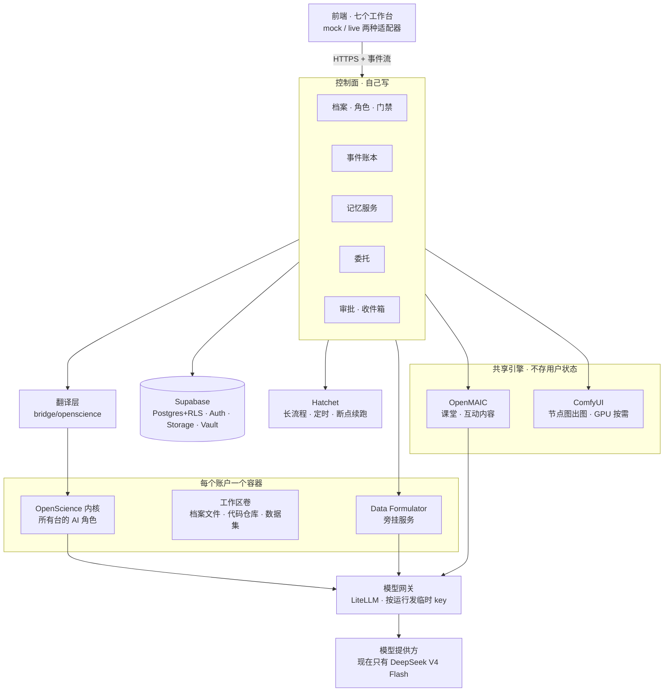
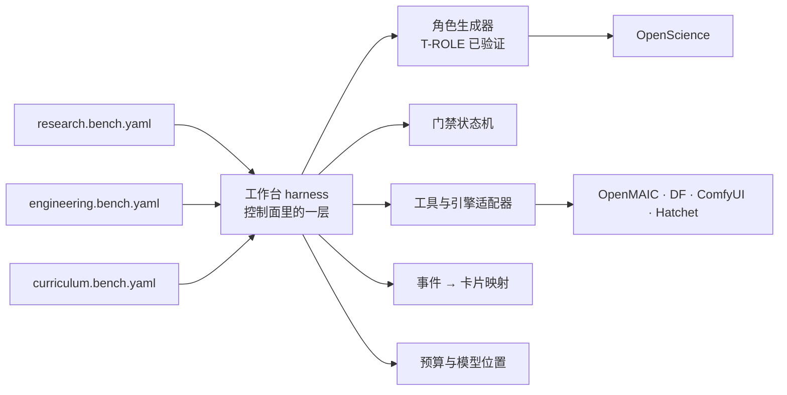

# 整体架构：七个工作台各用什么引擎

- 日期：2026-10-20
- 状态：草案。2026-10-20 用户已定：加模型网关、数据台用 Data Formulator 自带 AI、OpenMAIC 负责生成 + 渲染。工作台 harness（第 10 节）已确认
- 前提：
  - [BACKEND_SYSTEM.md](BACKEND_SYSTEM.md)：分层与部署；
  - [BACKEND_MEMORY_SESSION.md](BACKEND_MEMORY_SESSION.md)：记忆、会话、委托、翻译层；
  - [DEFERRED.md](DEFERRED.md)：第一阶段本地部署，全部用 DeepSeek V4 Flash。

## 0. 一句话

整个系统由四部分组成：

- **一个内核**：OpenScience。它跑所有工作台的 AI 角色。
- **几个专用引擎**：OpenMAIC、Data Formulator、ComfyUI、Hatchet。这些是内核不擅长、但已有成熟开源实现的事。
- **一个后端全家桶**：Supabase。负责数据、身份、文件、密钥。
- **控制面**：我们自己写的部分，把以上三样串起来，负责档案、门禁、账本、记忆、委托、审批。

研究台基本是 OpenScience 原样；课程台的课堂交给 OpenMAIC。其余五个台也按同样的思路分配：**能用内核角色 + 工具做的，就不引入新服务；只有内核做不了的，才接专用引擎。**

## 1. 总图



## 2. 七个台的分工

| 台 | 主引擎 | 内核里的 AI 角色 | 专用服务 / 工具 | 用户数据放在哪 |
|---|---|---|---|---|
| **研究 RSCH** | OpenScience（基本原样） | 精读助手、群研指挥与子 Agent、自研循环 | 解释动画 → OpenMAIC 单场景接口；GPU 实验 → Modal（暂缓） | 账户卷 + Supabase |
| **课程 CURR** | OpenMAIC（课堂）+ 内核（备课链） | 课程顾问、备课、独立审查、讲师、复核 | OpenMAIC 生成课堂与互动内容；调研委托给研究台，侦查与适配委托给自动化台 | `study_plan/` 在账户卷；课堂产物在 Storage |
| **工程 ENGR** | OpenScience（它本来就派生自写代码的 OpenCode） | 需求助手、开发助手、测试助手 | 代码仓库在账户卷；测试与预览服务在容器里运行；Claude Code / Codex 作为外部执行器（以后） | 账户卷（git 仓库） |
| **创作 CRTV** | 内核 | 设定顾问、写作助手、分镜导演 | 一致性检查读 L4 事实记忆；出图 → 自动化台节点图（ComfyUI）；视频暂缓 | 账户卷 + Storage |
| **自动化 AUTO** | Hatchet（例程）+ ComfyUI（节点图） | 例程助手、节点助手、维护 Agent | 定时、暂停等批准、断点续跑由 Hatchet 负责；节点图提交给 ComfyUI；「发布为工具」= 插件里多一个可调用工具 | 例程与版本在 Supabase；画廊在 Storage |
| **探索 EXPL** | 内核 | 计划助手、现场助手、回顾助手 | 插件工具：太阳位置（把前端 `sun.ts` 移到共享包）、天气（Open-Meteo，免费）、地点与路线（OpenStreetMap）；参考图暂缓（需要出图模型） | 账户卷 + Storage（照片） |
| **数据 DATA** | Data Formulator（照搬） | DataAgent 用 Data Formulator 自带的，不重写 | Data Formulator 作为旁挂服务跑在账户容器里 | 账户卷 |

## 3. 三种接入方式

每个台都只用下面三种方式之一，或者组合使用：

**A. 内核原生**（研究、工程、创作、探索，以及课程的备课链）
- 一个台 = 内核里的几个角色 + ReinLab 插件提供的工具。
- 角色隔离沿用 T-ROLE 已经验证过的方案：每个角色一个独立 project，默认全部拒绝，按白名单放行工具。
- 不同台之间的差别，只在角色提示词、工具表和门禁。

**B. 引擎服务**（OpenMAIC、Data Formulator、ComfyUI）
- 引擎保留自己的内部流程，控制面通过一个适配器调用它。
- 引擎的模型调用一律走**模型网关**（见第 4 节），带本次运行的临时 key，所以费用照样记进账本、受预算约束。
- 引擎的产物由控制面写回该账户的存储。引擎自己不保存用户状态，这样共享的引擎也不会串数据。

**C. 编排**（例程、课程备课链、维护工序、夜间任务）
- Hatchet 负责「按时启动、停下来等批准、失败续跑」。
- 每一步要么是一次内核运行（A），要么是一次引擎调用（B）。
- 门禁和审批仍以控制面为准，Hatchet 只负责调度。

## 4. 新增：模型网关

**已定（2026-10-20）：在控制面旁边加一个 LiteLLM（MIT 许可证）作为模型网关。**

- **对外：** 提供一个 OpenAI 兼容接口。OpenScience、Data Formulator、OpenMAIC 都把模型地址指向它。
- **临时 key：** 每次运行发一个临时 key，key 上直接设预算上限（LiteLLM 自带这个功能），正好对应运行预算。运行结束就作废这个 key。
- **真实 key 的位置：** 真正的 API key 只存在网关里（来自 Vault）。**账户容器和各个引擎都拿不到真实 key**，泄露面最小。
- **会员登录：** 会员登录不经过网关，仍在各人自己的容器里进行（ChatGPT、Copilot），或者走官方命令行执行器（Claude Code、Gemini CLI）。
- **记账：** 网关的用量回调写进账本，与 OpenScience 自己上报的用量互相核对。

第一阶段，网关后面只有一个模型：DeepSeek V4 Flash。以后加模型、换分档，只改网关配置。

## 5. 哪些按账户隔离，哪些共享

| 放在账户容器里（每人一份） | 共享（无状态，用运行令牌调用） |
|---|---|
| OpenScience 内核、工作区卷、代码仓库、数据集、Data Formulator | OpenMAIC、ComfyUI、模型网关、Hatchet、Supabase（靠 RLS 隔离） |

判定规则：**会长期持有用户文件的，放进账户容器；只做生成、做完就忘的，共享。** 共享引擎每次调用都必须带运行令牌，产物由控制面按账户写回。

## 6. 前端怎么接

- **适配器：** 每个台都有 `mock` 和 `live` 两种适配器。现在的前端模拟逻辑就是 `mock`，保留下来，作为演示模式和 T-REG 回归的基线。
- **事件协议：** 统一用 AgentDock 现有的五种事件（user / agent / tool / approval / card），由账本事件经事件流推给前端。研究台的规格已经这样定了，其他台照抄。
- **审批卡：** 审批卡、待批准收件箱、动作画布（审计）三样，所有台共用一套。

## 7. 各台要点

**课程 CURR**
- **OpenMAIC：** 只用来生成课堂（大纲、幻灯片、互动内容），也用它的原生渲染（方案 B 已在 iPad 上跑通）。
- **DeepTutor：** 只借鉴提示词，不搬架构。这是上次改造失败的教训。
- **备课链：** 门禁流水线由控制面的门禁状态机 + Hatchet 实现。各段工作是内核角色在做。
- **委托：** 「调研」「侦查与适配」两段通过委托合同交给研究台和自动化台，课程台只发起、审批、收结果。

**工程 ENGR**
- **代码位置：** 档案就是一个 git 仓库，放在账户卷里。注意它和角色 project 不同：角色 project 必须**不是** git 仓库。
- **测试与预览：** 测试在容器沙盒里跑；预览服务由控制面代理出来给前端看。
- **外部执行器：** 等会员接入以后，再加 Claude Code / Codex。

**创作 CRTV**
- **一致性检查：** 设定、人物、地点作为 L4 事实存进 pgvector。以后需要「关系 + 时间」时，再考虑 Graphiti。
- **待定：** 出图和视频依赖出图模型，第一阶段暂缓。

**自动化 AUTO**
- **常驻自动化与实时看板（2026-10-20 新增）：** 见 [AUTOMATION_LIVE.md](AUTOMATION_LIVE.md)。
- **例程：** 一段自然语言指令，由内核角色照着执行；定时与审批由 Hatchet 负责。
- **节点图：** 前端画布已经照搬 ComfyUI 的交互；后端直接提交 ComfyUI 的 workflow JSON。GPU 用 Modal 按需启动（暂缓），本地阶段可以先用 CPU 跑小图，或者只做排队和校验。
- **维护：** 沙盒重放时，由插件钩子拦截全部外部写入。

**探索 EXPL**
- **工具：** 太阳、天气、地点和路线都是确定性工具，计划由角色组织成计划书。
- **现场模式：** 按 iPad 设计，需要离线缓存当天的计划。
- **全网调研：** 委托给研究台。

**数据 DATA**
- **Data Formulator：** 原样作为服务，前端已经照搬了它的布局。
- **接入工作：** 只做两件事：把它的模型调用接到网关；把数据集读写限制在账户卷里。

## 8. 研究台之后的顺序（建议）

研究台的三期结束后，后面的台大多是「在同一套地基上换角色、换工具」，所以越往后越快。建议顺序：

1. **工程台**：内核本来就是写代码的 agent，复用比例最高，最快验证「一套地基跑多个台」。
2. **课程台**：用户构思最久的台。依赖研究台（调研委托）和 OpenMAIC（课堂），这两者到时都已就绪。
3. **数据台**：引擎现成，主要是接入工作。
4. **自动化台**：需要 Hatchet 例程和 ComfyUI，可以和课程台的备课链共用 Hatchet 经验。
5. **探索台、创作台**：依赖出图模型和多模态，等 DEFERRED 里的模型扩展完成后再做。

## 9. 已定（2026-10-20）

1. **模型网关：** 加 LiteLLM（第 4 节）。
2. **数据台：** 用 Data Formulator 自带的 AI，原样作为服务。它的 agent 不走角色隔离，所以要用三条边界来补：
   - 只能读写该账户卷里的数据目录；
   - 模型调用只走网关临时 key；
   - 写到别的台的动作（如交给创作台）必须经控制面审批。
3. **OpenMAIC：** 生成 + 渲染。课堂大纲、幻灯片、互动内容都由 OpenMAIC 生成；我们只管门禁、审批和产物落库。
4. **下一个台：** 用户提出在某一层放一个通用的 harness，见第 10 节。

## 10. 工作台 harness（2026-10-20 用户确认）

> 完整设计见 [HARNESS.md](HARNESS.md)。


**想法：** 不再一个台一个台地写后端，而是在控制面里放一层通用的「工作台 harness」。每个台只写一份**声明式清单**，由 harness 统一去做下面这些事：
- 建档案；
- 生成角色 project；
- 发工具权限；
- 跑门禁；
- 调引擎；
- 把事件翻译成前端卡片。



**清单长这样**（研究台精读，节选）：

```yaml
bench: research
dossier:
  layout: [papers/, notes/, swarm/, results/]
roles:
  read-assistant:
    prompt: prompts/research/read.md
    model_slot: mid              # 模型位置，映射到网关里的分档
    tools: { read: allow, cite_check: allow, write_layer: ask, task: deny }
    write_targets: [notes/]
    memory: { read: [L1, L2, L3], write: [L1] }
gates:
  read: [ingest, layers, qa, check, close]
engines:
  animation: { provider: openmaic, endpoint: scene-content }
delegations:
  to: [research.swarm, research.auto]
events:
  card_tools: [layer_card, citation_card, check_card]
budget: { default_cny: 5 }
```

**好处：**
- 研究台做完时，harness 也就做完了。后面每个台主要是「写一份清单 + 几个专用工具 / 适配器」，越往后越快。
- 隔离规则（默认拒绝、`task: deny`、只写 write_targets）由 harness 统一执行，不会因为某个台手写而漏掉。
- 「下一个做哪个台」变成「下一份清单写哪个」，代价小得多，可以并行。

**代价：**
- 研究台的 P1-10 ～ P1-12 不能再写死 research 专用逻辑，要从清单读取。工作量增加不多，但要现在就定，越晚改越贵。
- 清单格式要克制：只描述配置，不写逻辑。真正的业务逻辑仍在工具和适配器里。

**建议的下一份清单：** 工程台（engineering.bench.yaml），用来验证 harness 的通用性。

## 11. 集成方式：怎么用上游，才不会变成一堆散件

> MCP 能力层的完整设计见 [MCP_LAYER.md](MCP_LAYER.md)。


### 11.1 四种接法

| 接法 | 是什么 | 适合 | 代价 |
|---|---|---|---|
| **整站嵌入** | 把上游的完整应用原样跑起来，前端跳过去或 iframe 嵌进去 | 临时过渡 | 两套界面、两套登录、两份存储；审批和记忆割裂。**我们最怕的「散件」就是这么来的** |
| **服务 API** | 只跑上游的后端，前端用我们自己的 | 上游后端自带状态或 Python 生态（Data Formulator） | 要维护一个适配器 |
| **SDK / 库** | 直接引用上游发布的包，在我们自己的服务里调用 | 上游已模块化（OpenMAIC） | 跟随版本升级 |
| **MCP 工具** | 把一项能力包装成 AI 可调用的工具 | 给 Agent 用的能力 | 只适合「调用 → 返回」，不适合流式界面状态 |

**关键：MCP 不是「另一种用法」，而是加在最外面的一层门面。** 引擎本身用 SDK 或服务 API 接入；需要让 AI 调用的那部分能力，再包成 MCP 工具。

MCP 的额外好处：
- OpenScience（OpenCode 派生）原生支持挂 MCP 服务器；
- 以后接入的 Claude Code、Codex 执行器也都认 MCP；
- 所以**同一套能力，所有 Agent 都能用**，不用为每个执行器各写一遍。

### 11.2 OpenMAIC：用 SDK，不用整站，也不只做 MCP

OpenMAIC 已经拆成六个 MIT 包，正好是分层使用的形状：

| 包 | 作用 | 我们怎么用 |
|---|---|---|
| `@openmaic/dsl` | 课堂、幻灯片、动作、互动内容的数据格式与校验 | **课程台的数据契约**。账本、存储、前端都认这一种格式 |
| `@openmaic/generation` | 生成流水线：大纲 → 场景内容 → 动作 → 组装。不选模型、不读配置、不管存储，模型调用通过 `AICallFn` 注入 | 放进我们的「课堂引擎」服务，`AICallFn` 接模型网关的临时 key，所以费用进账本、受预算约束 |
| `@openmaic/renderer` | 幻灯片渲染（`SlideCanvas`） | 前端已经在用（课程台课堂、iPad 原生渲染） |
| `@openmaic/storage` | 可插拔的存储后端（浏览器 / HTTP / PostgreSQL） | 写一个 Supabase 后端：文档进 Postgres，素材进 Storage。课程数据只有一份 |
| `@openmaic/editor` | 课堂编辑器 | 以后需要「手改幻灯片」时再接，现在不用 |
| `@openmaic/importer` | 导入 PPTX 等 | 课程台「上传材料」时可用 |

**课堂引擎再暴露几个 MCP 工具：** `classroom.outline`、`classroom.scene`、`classroom.revise`、`classroom.grade`。这样：
- 课程台的备课、讲师角色调用它；
- 研究台的解释动画也调用它（取代现在直连 `scene-content` 接口）；
- 以后外部执行器也能调用。

**现在 3000 端口那个完整的 OpenMAIC 站点**（`codex/rhine-openmaic` 分支，莱茵主题）：
- 保留为**过渡**，继续用来生成和浏览已有课程；
- 课程台的 live 版本做好后，课程迁进 Supabase 存储，前端不再跳转到 3000 端口；
- 过渡期内，课程数据以 3000 端口站点为准，**不双写**。

### 11.3 七个台可复用的成熟件

| 台 | 引擎（SDK / 服务） | 做成 MCP 给 Agent 用的能力 | 可参考的成熟设计 |
|---|---|---|---|
| 研究 | OpenScience（含 Autoresearch）；PDF 解析可选 GROBID（Apache-2.0）；论文元数据用 OpenAlex / Semantic Scholar 开放接口 | 论文检索与获取、PDF 按页解析、引用核对、课堂动画（复用 `classroom.scene`） | Elicit / Consensus 的证据表、PaperQA2 的「回答必带出处」 |
| 课程 | OpenMAIC SDK（见上）；复习调度用 FSRS（`ts-fsrs`，MIT） | `classroom.*`、复习排期、rubric 评分 | DeepTutor 的备课提示词；间隔重复（Anki / FSRS） |
| 工程 | OpenScience 本身就是写代码的 agent | 浏览器测试用 Playwright MCP（微软官方，Apache-2.0）；代码托管用 GitHub 官方 MCP | Claude Code、Cursor 的工作流 |
| 创作 | 内核 + L4 事实记忆；出图走 ComfyUI | 设定集查询与一致性检查、出图（复用自动化台节点图工具） | NovelCrafter 的设定集（codex）、Sudowrite 的续写 |
| 自动化 | Hatchet（MIT）跑例程；ComfyUI（GPL-3.0，只经网络调用）跑节点图 | 「发布为工具」的节点图，每张图就是一个 MCP 工具 | Claude Code routines、ChatGPT Tasks 的例程形态；ComfyUI-Workspace-Manager 的工作区 |
| 探索 | 太阳与月亮位置（SunCalc，BSD；或我们现有的 `sun.ts`）、天气（Open-Meteo）、地点（OpenStreetMap Overpass / Nominatim）、步行路线（Valhalla 或 OSRM） | 太阳、天气、地点、路线四个工具 | PhotoPills 的星历与机位规划 |
| 数据 | Data Formulator 后端（MIT），作为服务 | 数据集概览、派生、出图（给其他台调用） | Data Formulator 本身 |

刻意不选的：
- **n8n：** 不是开源许可。
- **Windmill：** AGPL，对多人服务有传染风险。

### 11.4 防止散件的五条规矩

1. **一种前端：** 所有界面都是我们自己的设计语言（`--rh-*`、BenchFrame、AgentDock、Explorer）。上游界面只允许以**沙盒 iframe 里的内容**出现，比如 OpenMAIC 生成的互动 HTML，不嵌入上游的页面或应用。
   - 唯一例外：创作台的「Blender 实况」监视窗（noVNC），见第 12 节第 9 条。
2. **三条通道，互不越界：**
   - 前端只调控制面 API；
   - Agent 只通过 MCP 或插件工具调用能力；
   - 引擎只藏在适配器后面。
   - 任何组件都不直接调用另一个组件。
3. **每个上游只有一个适配器包**（`engines/<名字>/`），配一套契约测试。上游升级的流程：改版本号 → 跑契约测试 → 过了就升。
4. **状态只有一个家：** 数据只在 Supabase 和账户卷里。引擎尽量无状态，有状态的引擎（Data Formulator）只能读写账户卷里的指定目录。
5. **清单决定接线：** 每个角色能用哪些 MCP 工具、权限如何，都写在工作台清单里（第 10 节）。代码里不硬编码「某台用某工具」。

## 12. 已定（2026-10-23）

1. **可观测性：先用 OpenTelemetry 埋点，Langfuse 以后再加。**
   - 控制面统一用 OpenTelemetry 埋点。这是行业标准，以后换后端不用改代码。
   - 本地先接一个轻量的一体化后端。
   - 到调提示词最费劲的时候再加 Langfuse，它能直接接收 OpenTelemetry 数据。
   - 第一阶段这件事不急：事件账本和审计画布已经记下了运行、工具调用和费用。
2. **部署：** 第一阶段只用本地 Docker。
3. **档案版本：直接用 Git，不上 Gitea。**
   - 档案就是账户卷里的一个 git 仓库。
   - MR 是控制面里的一条记录，包括源分支、目标分支、WhatIf 结果和审批状态。审批通过后，由控制面执行 `git merge`。
   - diff 由 `git diff` 算出，交给前端的 DiffBlock 显示。
   - 保护分支（develop 只能经 MR 合并）由控制面门禁负责。
   - 有两点要注意：合并冲突要设计成前端能处理的形态；备份靠账户卷快照。
4. **记忆：** 由我们自己设计。Mem0、Graphiti、Letta 只作参考。
5. **文档解析：两种工具分工。**
   - 有文字层的电子版 PDF 和表格，用 Docling（MIT，CPU 上就能跑）。
   - 扫描件、公式多的教材和长书，用 [Unlimited-OCR](https://github.com/baidu/Unlimited-OCR)。它是 MIT 许可、3B MoE，用 vLLM 或 SGLang 起成 OpenAI 兼容服务。它需要 GPU，所以放在 DEFERRED「GPU / 多模态」一项。
6. **联网搜索：用 DeepSeek 的 Search 和 Fetch。**
   - 做成控制面的一个工具。费用记进账本，算进运行预算。
   - 价格：每千次成功请求 $0.75（国内 5 元），失败或空结果不收费。
   - 限制：每个账户每种接口 5 QPS；搜索词最长 128 字符；每次返回 1–50 条。
   - 待澄清：官方说是自建搜索引擎，但隐私政策提到「第三方搜索服务」。
7. **数据台：** 直接复用 Data Formulator（见第 9 节）。
8. **语音：用 MiMo。**
   - TTS 用 `mimo-v2.5-tts`，ASR 用 `mimo-v2.5-asr`（权重 MIT，以后可以自己部署）。
   - MiMo 走的是 `/v1/chat/completions`，不是 `/v1/audio/*`，所以要单独写适配器（`engines/mimo-audio/`）。
   - 小米在 2026-10-21 把大模型编号迁到了 V2.6。接入前要再核实一次语音模型的编号。
9. **创作台 3D 视口：暂用 Blender，前端仍不用 WebGL。**
   - 后端用 Blender 无界面模式，作为独立进程运行。它读场景 JSON，渲染视口画面，以及给视频模型用的深度、姿态和遮罩参考图。
   - 交互和数据格式借鉴现有项目，不复制代码：
     - Petty-Set：三种视图，以及把机位帧抓进分镜；
     - CozyClay：从镜头交给视频模型的流程；
     - Blockout：导出深度和姿态。
   - 如果交互太慢，再考虑别的方案。候选是只为这个视口放宽 WebGL，用 three.js 自己写，代码只参考 Blocking Room（MIT）。
   - 不直接改造 Petty-Set 或 CozyClay：两者都是 AGPL-3.0（已核实），作为服务提供时有传染问题。
   - **Blender 界面实况（2026-10-23 用户提出并确认）**：把 Blender 的界面调出来，直观展示 agent 是怎么操作它的。
     - 运行：账户容器里跑带界面的 Blender，用虚拟显示（Xvfb），第一阶段用软件渲染（Mesa llvmpipe）；低多边形白模够用。
     - agent 怎么操作：Blender 里装一个插件，开本地 socket 接收 `bpy` 指令。参考 [mcp-for-blender](https://github.com/ahujasid/mcp-for-blender)（原 blender-mcp，MIT，约 3.2 万星）。对外的工具仍按创作台动作表，放在适配器 `engines/blender/` 后面，经控制面门禁；agent 不能直接执行任意 Python。
     - 前端怎么显示：创作台视频面加一个「Blender 实况」监视窗，用 noVNC（Canvas 2D + WebSocket，不需要 WebGL）。默认只看；用户点「接管」后可以直接操作，接管期间暂停 agent。每一步操作同时记进审计画布，和画面对应。
     - 已定先用 noVNC。以后如果画面不够流畅，再换 Selkies（WebRTC，MPL-2.0）。
     - 例外：第 11.4 节第 1 条规定不嵌入上游应用的界面。这个监视窗是唯一的例外，用户已同意（2026-10-23）：它只放在我们的 BenchFrame 里面，不替代我们的界面。
     - 许可：Blender 是 GPL，作为独立进程运行，不影响我们的代码。我们自己写的 Blender 插件要用与 GPL 兼容的许可（如 MIT）。
     - 这样也缓解了「交互太慢」的担心：精细操作可以接管后直接在 Blender 里做。
