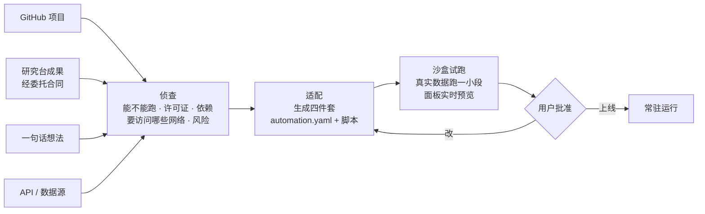

# 自动化台 · 常驻自动化与实时看板

- 日期：2026-10-20
- 状态：设计草案（用户已回答 4 个关键问题）
- 关系：在 [WORKBENCH_SPEC.md](WORKBENCH_SPEC.md) 第五节（例程 / 节点图 / 维护）之外，新增第三种形态；架构遵守 [ARCHITECTURE_BENCHES.md](ARCHITECTURE_BENCHES.md) 第 10、11 节

## 0. 用户的想法

自动化是「**后台维护的脚本 + 前端预览**」。

- **随时调出、随时调整：** 想看某个舆情的变化、跑一次舆情模拟、看盘口的实时波动，就能直接把它调出来，在后台调整。
- **新项目一句话接入：** 看到一个新项目，想把它变成自动化的一部分，直接和自动化台里的 agent 沟通，由它来实施。

## 1. 已定

| 问题 | 决定 |
|---|---|
| 实时性 | **第一版分钟级。** 为高频盘口和量化**预留扩展**：脚本接口第一天就按「以后能换高频后端」来设计 |
| 对外动作 | **只观察和告警。** 任何对外动作（发帖、回复、下单）只生成审批卡，由用户亲手执行。交易永远不自动执行 |
| 新项目来源 | 四种都要：GitHub 开源项目、研究台的成果、一句话想法、别人的 API 或数据源 |
| 面板 | **以声明式为主，HTML 兜底。** AI 写 Vega-Lite 图表描述，套莱茵组件；特别复杂的才写沙盒 HTML |

## 2. 三种形态

| 形态 | 什么时候跑 | 例子 | 已有 / 新增 |
|---|---|---|---|
| 例程 | 定时，跑一次就结束 | 每日资料整理、周报 | 已有 |
| 节点图 | 排队，跑一次就结束 | 出图、封面 | 已有 |
| **常驻** | 一直在跑，持续产出数据流 | 舆情监测、盘口波动、价格看板 | **新增** |
| **模拟** | 按参数批量跑，结果可以比较 | 舆情扩散模拟、策略回测 | **新增**（常驻的一个变体） |

## 3. 一个常驻自动化 = 四件套

每个常驻自动化用一份清单描述（`automation.yaml`）。它是工作台清单思路（第 10 节）在自动化单元上的延伸。

```yaml
id: sentiment-ev
title: 新能源车舆情
kind: live                    # live（常驻）| simulation（模拟）
runtime: { lang: python, entry: main.py, cpu: 0.25, memory_mb: 256 }
cadence: 5m                   # 第一版最快 1 分钟
network:                      # 只能访问这些域名
  allow: [rss.example.com, api.example.com]
params:                       # 旋钮，用 JSON Schema 描述，前端自动生成表单
  keywords: { type: array, items: { type: string }, risk: low }
  sources:  { type: array, items: { enum: [rss, forum, news] }, risk: medium }
  alert_threshold: { type: number, default: -0.3, risk: low }
streams:                      # 脚本产出的数据流
  sentiment: { time: ts, fields: { score: number, volume: integer, source: string } }
  mentions:  { time: ts, fields: { title: string, url: string, score: number } }
panel:                        # 声明式面板：莱茵栅格 + Vega-Lite
  - { kind: line,  stream: sentiment, x: ts, y: score, color: source, span: 8 }
  - { kind: stat,  stream: sentiment, field: volume, agg: sum, window: 1h, span: 4 }
  - { kind: table, stream: mentions, sort: -ts, limit: 20, span: 12 }
alerts:
  - { when: "sentiment.score < params.alert_threshold for 15m", notify: inbox }
maintainer: automation.maintainer   # 维护它的 agent 角色（在工作台清单里定义）
actions: none                        # 只观察；对外动作一律走审批卡
```

**脚本只做一件事：** 采集、计算，然后通过一个很小的 SDK 交出数据：`rl.emit("sentiment", row)`。读取参数用 `rl.params()`，参数变化时自动热更新，不用重启。

脚本**不**直接连数据库，也**不**直接推送给前端。这层 SDK 就是以后换高频后端的那个接口（第 6 节）。

## 4. 运行在哪里

- **运行位置：** 常驻自动化跑在**账户容器**里，由一个「运行器」负责启动、停止、重启和资源限额。
- **隔离：** 每个自动化一个独立进程沙盒，网络只放行清单里列出的域名。
- **数据路径（第一版）：** `emit` → 控制面写入 Postgres 的时序表（RLS 隔离，按时间分区，旧数据自动降采样）→ Supabase Realtime 推送给前端面板。
- **参数修改：** 每次修改都是账本里的一条版本事件。低风险参数直接生效，中、高风险参数走审批卡。改错了能一键回到上一版。
- **出问题时：** 维护 Agent 走现有维护面的流程：诊断 → 修复 diff → 沙盒重放 → 用户批准上线。

## 5. 新项目怎么接进来

四种来源走同一条流水线。这条流水线和课程台「侦查与适配」委托给自动化台的是同一条。



- **GitHub 项目：**
  - 侦查时先查许可证。AGPL、GPL 等会传染的许可证，在报告里标出来。
  - 依赖只在沙盒里装，不碰账户的其他目录。
- **研究台成果：** 通过委托合同进来，带着出处，面板上能回链到研究档案。
- **一句话想法：** 由 Agent 从零写脚本，同样要经过试跑和批准。
- **API / 数据源：** 凭据由用户在界面里填，进 Vault，脚本只拿到运行时注入的值，不经过聊天。

## 6. 为高频和量化预留的扩展

第一版只做分钟级，但下面三点**现在就要守住**，以后换高频时脚本不用改：

1. **脚本只通过 `rl.emit` / `rl.params` 交互。** 换高频后端时，SDK 背后的实现换掉就行：
   - 写入：改为账户内的列式时序库（例如 QuestDB 或 ClickHouse，都是 Apache-2.0）；
   - 推送：改为直接走 WebSocket；
   - 原始数据：落 Parquet，供回测使用。
2. **流的结构在清单里声明。** 存储和面板都按声明工作，不猜字段。
3. **模拟形态和回测共用一套「参数扫描 + 结果比较」界面。** 以后接量化研究（例如微软的 Qlib，MIT）时，回测就是一种模拟。

**范围外：** 自动下单、交易执行，以及任何形式的投资建议。盘口自动化只负责看、算、告警；任何交易动作都只生成审批卡，由用户自己去券商或交易所执行。

## 7. 前端：新增「看板」面

- **看板 LIVE**（自动化台第四个面）：
  - 所有常驻自动化以实时小面板排成栅格，类似 Grafana；
  - 每块显示状态（运行中 / 告警 / 失败 / 等你批准）和最近一次数据时间。
- **点开一个：**
  - 左边是放大的面板；
  - 右上是旋钮，由参数的 JSON Schema 自动生成表单，旋钮旁标出风险等级；
  - 右下是和维护 Agent 的对话，比如「把阈值调到 -0.5」「加上论坛来源」；
  - 底部是运行日志和参数版本时间线。
- **到处可调出：** 面板是一个共享组件 `LivePanel`，可以钉到别的台里。例如把舆情面板钉进研究档案，或者在课程台引用一条实时数据。
- **模拟：** 参数扫描的结果并排比较（例如三种舆情干预方案的扩散曲线），每次模拟都是一个可回放的运行。
- **视觉：** 图表用 Vega-Lite 套莱茵皮（与数据台共用一套图表样式），Canvas 2D 或 SVG，不用 WebGL。

## 8. 可借用的成熟件

| 用途 | 选择 | 许可证 |
|---|---|---|
| 舆情模拟引擎 | OASIS（CAMEL-AI，大规模社交媒体智能体模拟） | Apache-2.0 |
| 图表描述 | Vega-Lite（与数据台、Data Formulator 一致） | BSD-3 |
| 实时推送 | Supabase Realtime | Apache-2.0 |
| 高频扩展的时序库 | QuestDB / ClickHouse（以后） | Apache-2.0 |
| 量化研究、回测 | Qlib（以后） | MIT |
| 交互参考 | Grafana（看板）、Home Assistant（自动化 + 仪表盘）、Streamlit（脚本即界面） | 只参考设计 |

## 9. 分期

1. **前端模拟**（照前面七个台的做法）：看板面、详情页、接入流水线。示例用「新能源车舆情」「BTC 盘口波动（只看）」「舆情扩散模拟」三个。
2. **后端第一版：**
   - 运行器、`rl` SDK、分钟级时序表 + Realtime；
   - 参数版本与审批；
   - 接入流水线（复用维护面的沙盒）。
3. **模拟：** 接 OASIS；参数扫描与比较。
4. **高频扩展：** 换时序后端、接回测；仍然不做交易执行。
