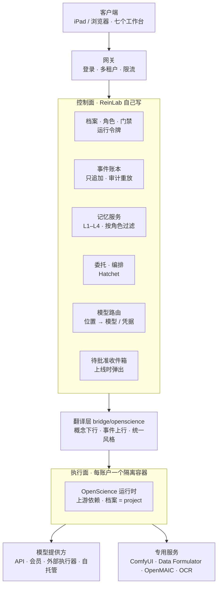
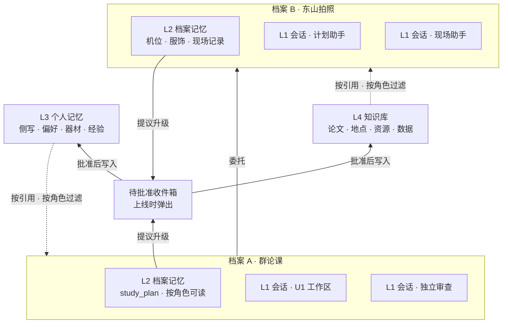
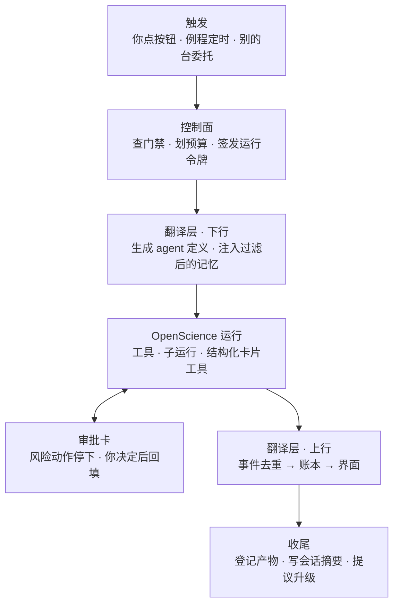
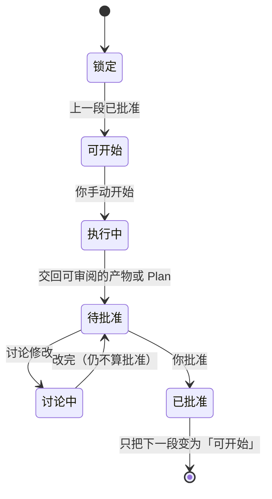
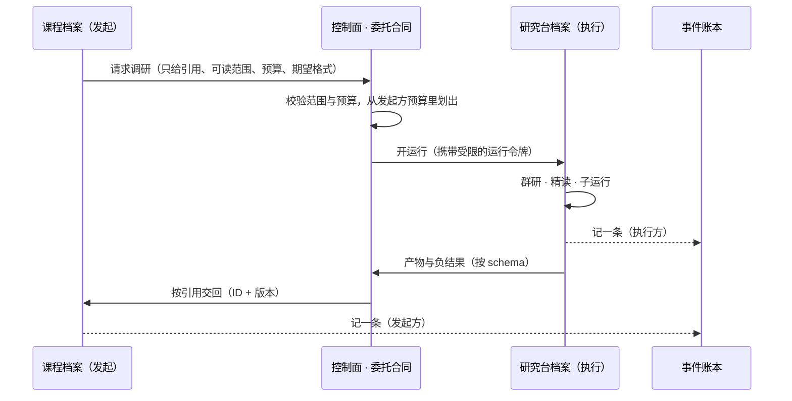
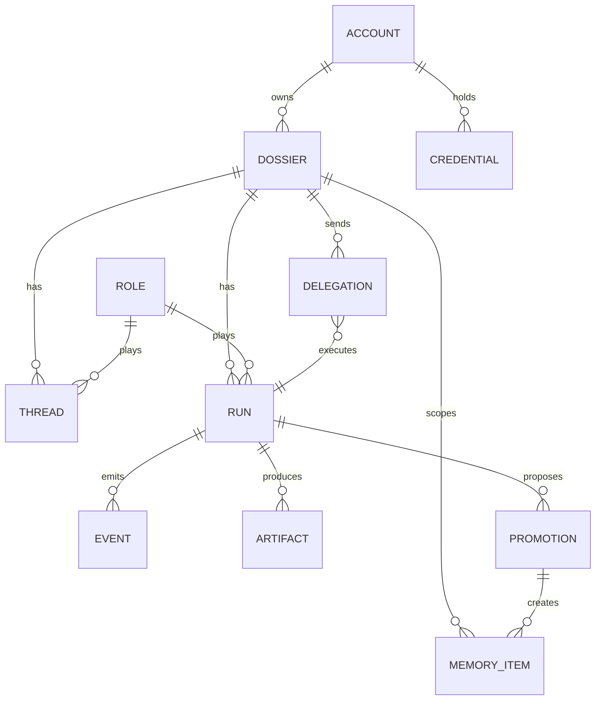
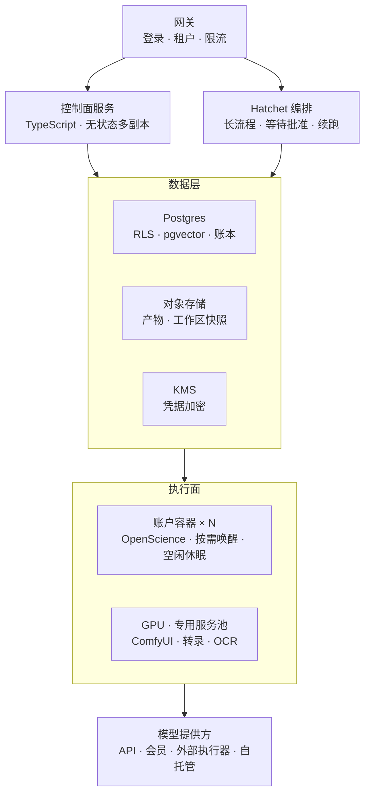

# 后端设计 · 总览：整个系统

版本 0.1 · 2026-10-18 · 配合 [BACKEND_MEMORY_SESSION.md](BACKEND_MEMORY_SESSION.md)（记忆与会话的规则细节）一起读

这份文档只放结构，规则写在记忆与会话那一篇。八张图依次回答八个问题：

1. 系统分几层
2. 记忆怎么流动
3. 一个需求怎么穿过多个工作台
4. 一次运行经过哪些环节
5. 门禁怎么流转
6. 台与台之间怎么委托
7. 数据存在哪里
8. 云上怎么部署

---

## 1. 分层



- 控制面是我们自己写的部分。
- 翻译层是唯一同时认识 ReinLab 与 OpenScience 两边的地方。
- 执行面原样使用 OpenScience，跟随上游升级。

## 2. 记忆的流动



会话之间、档案之间默认互相看不见。

## 3. 跨台长链

```mermaid
flowchart LR
  subgraph 学一样东西 → 沉淀成可用项目
    R1[研究台<br/>研判 · 调研] --> C1[课程台<br/>学习 · 理解] --> E1[工程台<br/>应用 · 做成项目] --> A1[自动化台<br/>变成例程]
  end
  subgraph 约一次拍摄 → 一部作品
    R2[研究台<br/>全网调研景色] --> X2[探索台<br/>机位 · 方案 · 现场] --> K2[创作台<br/>后期 · 小说] --> A2[自动化台<br/>归档 · 回收]
  end
```

每个箭头都是一次委托（第 6 张图），它们共用同一个底座：账本、记忆、委托、门禁、模型路由。

## 4. 一次运行的生命周期



## 5. 门禁状态机



适用于：课程的七段备课、维护的四道工序、例程上线，以及所有「写入需批准」的动作。门禁的判断放在控制面，页面、聊天、接口三个入口走同一个判断。

## 6. 一次委托



## 7. 控制面数据模型



- 每张表都带 `account_id`，用 Postgres 行级安全（RLS）做租户隔离。
- `EVENT` 只追加，去重键是 OpenScience 的 runID + sequence。
- `MEMORY_ITEM.layer` 取 L1–L4，`supersedes` 串起版本链。
- `PROMOTION` 批准后才生成 L3 / L4 的条目。
- `CREDENTIAL` 只存类型与指纹，密文放在 KMS 里。

## 8. 云端部署



### 8.1 已定（2026-10-19）

前提：第一年为你自己加少量朋友（< 20 人）；进入工作台要求永远秒开；用托管平台，尽量不管服务器；服务器放在亚洲。

| 部件 | 选择 | 说明 |
|---|---|---|
| 地区 | **东京**（新加坡备选），**不用香港** | 据目前了解，OpenAI / Anthropic 的 API 不对香港提供服务；日本、新加坡在支持范围内。开通前逐家核对 |
| 账户容器 | **Fly.io Machines**，每账户一台**常驻**机器 + 一块持久卷（档案工作区） | 控制面通过 Machines API 为账户建、停、扩机器；工作区每晚快照到对象存储 |
| 控制面、Hatchet | Fly 同区，各 2 副本 | 与账户容器内网互通 |
| 数据库、身份、对象存储、密钥 | **Supabase**（东京） | 托管 Postgres，原生支持 RLS 与 pgvector；Auth 作为网关身份层；Storage 放产物与快照；Vault 存凭据，应用层再加一层信封加密 |
| GPU | **Modal 按需** | 只在 ComfyUI 出图、研究台实验时拉起；复用 OpenScience 已有的 Modal 计算控制面。起步阶段不自建、不常驻 GPU |

**秒开怎么保证：**
- 界面数据（档案、账本视图、记忆）由控制面直接给，不依赖账户容器。
- 账户容器常驻，第一次调用 Agent 不用等唤醒。
- 将来用户多了，只需把常驻改成「空闲休眠、按需唤醒」，架构不变。

**成本量级（以开通时价格为准）：**
- 常驻账户容器：约每人每月 10–20 美元。
- Supabase 付费版：每月 25 美元起。
- GPU：按秒计费。
- 20 人以内合计约每月一两百到三百美元，主要随常驻人数增长。

**开通前要核实的：**
1. Fly 东京区当前提供的机型与卷。
2. 各模型提供方对日本 / 新加坡出口 IP 的支持情况。
3. Supabase 东京区的套餐限制。

---

## 还没定的（下一轮讨论）

1. **研究台第二篇：** 群研的 Agent 间通信在 OpenScience 之上补多少。
2. **前端托管：** 前端静态资源放在哪里（Fly 同站，或 CDN），以及大陆访问速度要不要额外加速。
