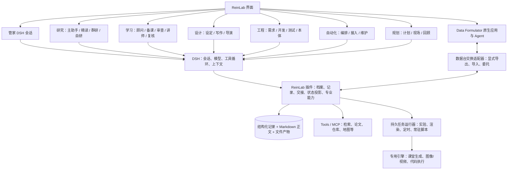

# ReinLab：DSH 基底与七个实验室功能设计

2026-10-27 · 讨论稿 v0.1 · 非实现完成报告

本稿依据本次用户讨论，以及 WORKBENCH_SPEC.md、AUTOMATION_LIVE.md、PRD_RESEARCH_BENCH.md 整理。用户的新决定优先于旧规格。旧文件不在本次改写，避免把尚未讨论的提案变成已确认要求。

## 0. 已确认与本稿提案

已确认：七个实验室独立、各自拥有档案；一个研究档案允许精读、群研、自研；研究主助手维护方向和共享记忆；管家可以建议和准备，建档与跨台委托经用户确认；DSH 是 Agent 基底，扩展通过插件、工具、MCP；数据台完整使用 Data Formulator。Provider 余额不足要清楚提示并可充值或换 Provider，不能通过账户预算冻结阻断其他工作。

本文中的工具名、插件分组、数据字段、会话粒度和状态均为提案，不代表 DSH 已有同名接口。插件可以注册工具；MCP 是提供工具的服务边界，不是另一套 Agent 调度系统。适配 DSH 的具体会话、子 Agent 和压缩生命周期接口要在固定版本上核实。

术语对应：学习=原课程 CURR；设计=原创作 CRTV（世界观、小说、漫剧/影片）；规划=原探索 EXPL（当前重点是旅行与摄影）；其余为研究 RSCH、工程 ENGR、自动化 AUTO、数据 DATA。

## 1. 总体结构与运行边界

DSH 运行 Agent，运行器执行程序：实验、转码、渲染、周期采集不能依赖一个永不结束的模型对话。运行器可以由插件调用，负责 job_id、状态查询、取消和结果定位；具体复用哪种调度服务待验证，暂不再指定另一套控制面。长任务返回 job_id，DSH 可结束当前轮，完成事件再触发后续处理。

界面操作和 Agent 工具调用相同业务动作；工具内部验证档案范围、版本和已确认决定。纯编辑、图表渲染、指标计算、状态查询不必调用模型。档案隔离还要落实到文件与工具访问范围，不能只注入一句提示词。

## 2. 管家与公共功能

| ID | 功能与用户流程 | 实现与产物 |
|---|---|---|
| G01 | 自然语言入口：模糊想法→澄清→推荐实验室或已有档案 | 管家会话；检索档案摘要，不默认读取全部档案正文 |
| G02 | 建档预览：目标、所属实验室、初始材料→用户确认 | dossier.prepare/create；确认对应具体草案，创建独立档案 |
| G03 | 进度查询：做到了哪里、为何停下、下一步 | 各台状态投影，包含更新时间、结果引用、阻塞原因；管家负责解释 |
| G04 | 档案管理：浏览、重命名、归档、导出、搜索 | 非模型动作；恢复归档保留任务与引用，删除单独处理 |
| G05 | 收信箱：待确认建档/委托、需要用户回答、任务完成、故障 | 区分审批、提问、通知；不把所有工具事件塞进收信箱 |
| G06 | 委托：源档案准备摘要与材料范围→确认→目标台建档 | delegation_id 贯穿源、目标、结果；重复确认不重复建档 |
| G07 | 委托回传：目标档案交成果→源档案审阅采用 | 返回版本化产物引用和局限；目标不自动修改源档案正文 |
| G08 | Provider 设置与故障恢复 | 选择默认模型及任务覆盖；余额/连接/限流错误分别说明；用户切换后从检查点恢复 |
| G09 | 停止、继续与离线返回 | 区分停止模型对话和取消运行中 job；不因关闭页面丢失任务 |
| G10 | 文件、引用、版本与活动记录 | 共享文件服务；每个产物有来源任务、版本、时间；用户可追到原文 |
| G11 | 教练跟进 | 仅跟进用户设定的目标或明确订阅；提醒包含理由与可执行下一步 |

管家不能把推测写成任务已完成。Provider 切换不承诺原生内部推理状态可迁移：可迁移的是任务记录、检查点、可读历史与产物。若任务调用返回结果未知，先查状态，不盲目重复执行。

## 3. 研究实验室 RSCH

档案单位：一个研究课题。主助手维持主对话，精读/群研/自研按任务建立会话。阅读一篇论文可服务于多个任务，但引用固定到材料版本。

流程：模糊想法→主助手澄清→选定研究问题→精读/群研/自研→综合证据→修正问题或形成成果；三个模式可反复往返，不是强制流水线。

| ID | 功能与交互 | Agent / Tools / MCP | 保存与完成条件 |
|---|---|---|---|
| R01 | 研究咨询：说想法、判断研究范围、建议适合的模式 | 主助手；record.search、task.prepare | 问题、边界、开放项；不确定时仍可继续讨论 |
| R02 | 模糊找论文、链接/DOI/上传导入 | 精读助手；文献检索、网页、文件工具 | 候选来源、材料版本；用户选定论文，Agent 不代选 |
| R03 | 取得全文、解析与定位 | fetch/parse/OCR 工具；受限材料可上传 | 原文件、页码/段落、抽取质量；只有摘要时明确标记 |
| R04 | 原文与分层讲解联动、批注、引用追问 | 精读会话；paper.read、note.write | 讲解、引用、未解问题；点击说法回到原文 |
| R05 | 理解检查与互动解释 | 精读助手；题目工具、课堂/互动内容引擎适配器 | 作答、解释、互动产物；可跳过，不是正式学习认证 |
| R06 | 小规模复现 | 精读→实验任务；仓库、环境与执行工具 | 环境、步骤、实际结果、差异；不将读论文算成复现 |
| R07 | 发现管理与模式交接 | finding.create、task.prepare | 论文主张/假设/观察分开；同档案交接只携带问题与引用 |
| R08 | 群研计划：拆题、分工、可交付结果 | 协调 Agent；任务插件 | 问题树、任务依赖、角色计划；用户可调整 |
| R09 | 群研执行与交流 | 独立子会话；检索工具、黑板、定向提问工具 | 任务进度、公开发现、提问/反驳；可点开可见工作记录 |
| R10 | 独立反驳、核实与综合 | 评审角色先独立再对照；source.open | 支持、反对、未知；结论保留证据与分歧 |
| R11 | 从想法形成论文 | 主助手+写作任务；引用、图表、导出工具 | 论证提纲、相关工作、方法、结果、局限、草稿；缺实验标缺口 |
| R12 | 自研立项与基线 | 自研助手；experiment.prepare/run | 指标方向、评价脚本、数据划分、代码版本、基线与资源约束 |
| R13 | 迭代提出方案、改动、运行、比较 | 自研循环；隔离代码分支、持久实验运行器 | 每轮变更、配置、原始指标、产物、解释；失败尝试也保留 |
| R14 | 指标曲线、试验对照、最佳版本、停止继续 | 数据查询与图表，不依赖模型算数 | 点开曲线到具体试验；不同评价协议不混为同一可比曲线 |
| R15 | 研究收尾与经验提议 | 主助手；report/export、memory.propose | 报告、负结果、待解问题；跨档案经验需用户确认 |

记忆：主助手读有效决定、进度、发现索引；精读读任务与相关论文；群研子任务读必要背景且不默认继承他人结论；自研读评价协议、基线、近期试验和相关失败。论文解释/报告用 Markdown；论文定位、发现状态、任务关系、实验指标用结构化数据。Agent 记录结论，执行器记录真实指标。

恢复锚点：材料版本与阅读位置；群研 task_id 与已提交报告；自研 protocol_version、job_id、代码版本、最后已完成 experiment_id。

## 4. 学习实验室 CURR

档案单位：一个学习目标/课程，可有多个单元。实验室共享经过确认的用户 profile 和带证据的学习 map；角色之间隔离教学材料和考核答案。

三种入口：系统学习→诊断与路线；掌握技能→实践任务与反馈；核验掌握→直接诊断，按结果决定是否学习。

| ID | 功能与交互 | Agent / Tools / MCP | 保存与完成条件 |
|---|---|---|---|
| L01 | 目标咨询、先修诊断、时间与偏好 | 学习顾问；profile.read、map.read、diagnose | 学习目标、成功标准、约束、诊断证据 |
| L02 | syllabus、路线、课程与资源调研 | 准备研究委托→用户确认→新研究档案 | 资源比较、适用基础、课程路径与来源；空缺也保留 |
| L03 | 核验资源可达、可下载、可读 | 侦查工具；需要安装适配时委托自动化 | 资源状态、链接、访问时间、替代、未解决缺口 |
| L04 | PDF/字幕/代码练习环境适配 | 转换工具或自动化委托 | 页码/时间戳映射、练习环境地址、转换抽查 |
| L05 | 课程蓝图与单元规划 | 顾问/备课 Agent；curriculum.write | 目标—单元—知识点—评价关系；用户确认课程方向 |
| L06 | 单元备课 | 备课 Agent；lesson.build、source.open | 有来源的讲解、练习、评分规则、误区与补救 |
| L07 | 独立审查与修订 | 独立审查会话；lesson.review | 缺出处、错误解答、评分缺陷及修订记录；未通过不能标可开课 |
| L08 | 课堂生成与呈现 | DSH 管学习流程；课堂引擎作为生成/呈现服务 | 课件、互动内容、播放进度；讲师运行边界需按引擎接口明确 |
| L09 | 单元对话与原文精读 | 讲师会话；带单元、材料位置提问 | 问答、批注、困惑；同单元持续，跨单元按相关性取知识 |
| L10 | 练习与技能实践 | 练习助手；作答、代码运行、作品检查工具 | 尝试、反馈、提示使用、成果；练习结果不直接等于掌握认证 |
| L11 | 正式考核与独立复核 | 考核/复核独立角色；锁定 rubric | 作答、评分依据、申诉、更正；错误标准答案不计学生错误 |
| L12 | 复习与补救 | 根据学习 map、近期表现规划 | 复习队列、补救目标；不向学生侧会话暴露未作答考核答案 |
| L13 | 学习收尾与 map 更新 | 记录实际证据；提议长期侧写变更 | 接触/练习/验证掌握/待复习；带时间和来源，不永久贴能力标签 |

Markdown：学习目标说明、资源报告、讲解、反馈。结构化：单元依赖、资源定位、题目、作答、rubric 版本、学习证据、map。恢复锚点：单元、课件位置、最后作答、考核 attempt_id；不因重启重新提交作答或改换评分规则。

旧规格的“每阶段都要点批准”“最多三次修订”等属于既有草案，是否保留要逐项讨论；不把点击次数当成教学质量保证。

## 5. 设计实验室 CRTV

档案结构：世界观作为明确的共享范围，其下可有多个小说和漫剧/影片作品。作品可以独立无共享世界观。novel_exp、movie_exp 是经验，设定是故事事实，两者分开。

| ID | 功能与交互 | Agent / Tools / MCP | 保存与完成条件 |
|---|---|---|---|
| C01 | 创作意图、受众、风格、作品结构 | 创作顾问；作品草案工具 | 创作简报、作品与世界观关联；新建经用户确认 |
| C02 | 人物、地点、势力、物件、规则管理 | 设定 Agent；world.read/propose | 实体、描述、参考图、声线与版本 |
| C03 | 关系图、年表、地图与出现位置 | 图/时间/引用工具，前端呈现 | 关系、事件、坐标、章节/镜头反向引用 |
| C04 | 正式设定、提案与平行分支 | canon.propose/adopt、分支对照 | 用户采纳后进入正式设定；不同作品分支不互相覆盖 |
| C05 | 大纲、卷章场景、节拍板 | 写作助手；outline/edit | 大纲正文、场景顺序、叙事目标、伏笔索引 |
| C06 | 起草、续写、改写、逐段接受 | 写作会话；正文编辑与差异工具 | 正文版本、用户采纳的修改、引用实体 |
| C07 | 连续性与设定冲突检查 | 检查角色；canon.query、consistency.check | 冲突位置、依据、修法；有意伏笔可记录理由 |
| C08 | 小说转漫剧/影片 | 导演助手；scene.to_shots | 场景、镜头、对白、角色参考映射；小说保留独立版本 |
| C09 | 白模场景与机位运镜 | 场景编辑工具；Blender 等执行适配器候选 | 场景描述、人物站位、焦距、路径、参考帧；先验证交互延迟 |
| C10 | 角色参考、图像、镜头视频候选 | 生成工具/自动化已发布工具；媒体 Provider | 输入参考、生成参数、job_id、候选与选中版本 |
| C11 | 配音、音乐、字幕与剪辑 | 导演助手；音频/字幕/剪辑工具 | 音轨、字幕时序、镜头时长、时间轴与来源 |
| C12 | 预览、连续性复核、局部重做、导出 | 渲染工具与检查角色 | 构图对照、成片、失败镜头；只重做受影响片段 |
| C13 | 经验沉淀 | novel_exp/movie_exp 提议 | 记录具体有效方法、适用条件；用户确认跨作品复用 |

Markdown：设定说明、大纲、正文、导演说明、经验。结构化：世界观实体、时间线、作品分支、镜头表、参数、时间轴、产物关系。恢复锚点：作品/世界观版本、章节、镜头、媒体 job_id；生成成功但响应丢失先查询任务。新正文的事实不是自动成为所有作品的正式设定。

## 6. 工程实验室 ENGR

档案单位：一个代码仓库/工作区。需求、开发、测试、本体共用追溯关系。会话按需求变更、issue、测试批次分开；开发任务可以包含多个分支，不把“一 issue 永远恰好一个分支”做死。

| ID | 功能与交互 | Agent / Tools / MCP | 保存与完成条件 |
|---|---|---|---|
| E01 | 仓库导入、环境识别与运行 | 工程助手；git、环境检测、进程工具 | 仓库位置、分支、依赖、启动方式 |
| E02 | 需求编辑、补全与验收标准 | 需求助手；Markdown 编辑工具 | REQ/AC 标识、用户故事、约束、开放问题、Git diff |
| E03 | WhatIf 与本体一致性检查 | 本体查询/规则工具，可接 MCP；Agent 做语义分析 | 冲突与依据、影响范围；区分规则失败和模型建议 |
| E04 | 需求变更审阅与 issue 拆分 | diff、Git/托管服务工具 | 用户采纳的需求版本、issue 预览、追溯关系 |
| E05 | 开发计划、技术规格与代码实现 | DSH 开发会话；文件、shell、git 工具 | 计划、代码、技术决定；按任务绑定正确工作区 |
| E06 | 分支/worktree、并行任务与检查点 | 工作区工具；会话关联插件 | 分支—任务关系、提交、工作区状态；恢复先检查实际文件 |
| E07 | 预览、点选引用、文件与终端 | 预览进程、浏览器/终端工具 | 服务状态、元素引用、日志；前端选择带回对应任务 |
| E08 | API 探索与契约测试 | OpenAPI 读取、请求工具、断言执行 | 请求响应、契约差异、环境与运行 ID |
| E09 | Diff 审查与架构图 | git diff、结构抽取；审查 Agent | 行内意见、架构关联、修复状态 |
| E10 | 从 AC 形成测试用例、执行与定位 | 测试助手；测试框架、浏览器执行器 | 期望/实际、截图、DOM、日志、录屏；实际结果由运行器记录 |
| E11 | 环境矩阵、回归与缺陷反馈 | 批次运行工具与报告 | 覆盖关系、失败共因、重跑范围；反馈定位到开发任务 |
| E12 | 本体图、需求树、分支比较、影响分析 | 模型/图查询工具 | 概念、约束、关系、REQ→AC→issue→commit→case 链 |
| E13 | 合并与交付 | 检查结果+用户确认；git/托管服务工具 | 实际合并提交、交付说明、更新本体；不能仅凭 Agent 自报测试通过 |

Markdown：需求、设计、评审、交付说明。Git 文件是代码与受版本管理文档的权威来源，数据库只保存定位/版本与追溯索引，不复制一份可独立编辑的正文。结构化：issue、追溯、测试结果、环境。跨档案只共享确认过的通用偏好与模板，不共享其他仓库业务事实。

## 7. 自动化实验室 AUTO

档案单位：一个自动化项目，可包含若干例程、节点工作流和常驻服务。DSH 负责理解、搭建、解释与维修；程序运行器负责定时和持续执行。

| ID | 功能与交互 | Agent / Tools / MCP | 保存与完成条件 |
|---|---|---|---|
| A01 | 从 GitHub/API/研究成果/一句话接入 | 接入助手；仓库、文档、连接器工具 | 能力、依赖、访问范围、运行办法与未知项 |
| A02 | 编排例程：触发、步骤、输入输出 | 编排 Agent；workflow.prepare/edit | 指令正文、触发规则、参数、工具清单、产物定义 |
| A03 | 预演、实际试跑与上线 | dry-run/试跑工具；用户确认发布 | 预演标明未执行；试跑记录真实结果；已发布版本固定 |
| A04 | 定时、手动、事件触发与重入控制 | 持久调度工具；需要判断的步骤才启动 DSH | schedule/run_id、时区、重叠策略、取消状态 |
| A05 | 运行矩阵、逐步记录、待处理动作 | 任务事件查询与面板 | 成功/失败/等待/取消、输入输出引用、错误原因 |
| A06 | 节点画布、参数连线、模板 | 节点编辑器；ComfyUI 适配器候选 | 引擎工作流 JSON、版本；类型不匹配时执行前提示 |
| A07 | 模型依赖、队列、批量、历史画廊 | 引擎工具/任务接口 | 缺失依赖、job_id、种子、参数与输出；不虚构模型存在 |
| A08 | 工作流发布为工具 | tool.publish | 用户选参数、固定版本、输入输出 schema；其他台可按授权调用 |
| A09 | 常驻脚本、参数与实时面板 | 运行器、数据流工具；维护 Agent | 脚本、参数、流定义、面板；展示最新数据时间与运行状态 |
| A10 | 告警与通知 | 条件计算、去重、恢复状态工具 | 状态变化通知；重复无变化保持安静，沿用现有只观察范围 |
| A11 | 参数扫描与模拟比较 | 批量 job 工具；Agent 分析 | 每次参数、随机种子、数据快照、结果；模拟与实测分开 |
| A12 | 故障诊断、修复 diff、沙盒重放 | 维护 Agent；日志、编辑、重放工具 | 原因、改动、验证结果；重放不重复外部写入 |
| A13 | 发布修复、回滚、暂停停用 | 版本与进程工具，发布按用户确认 | 已部署版本、运行健康；暂停调度不默认杀死所有在途任务 |
| A14 | 学习与工程委托 | 学习项目理解→学习台；超出适配范围的产品开发→工程台 | 明确目标、材料与预期结果，确认后建目标档案 |

Markdown：操作说明、诊断、维护经验。结构化：触发、图、参数 schema、版本、run/job、时序数据、告警。跨档案共享工具目录与模板，不默认共享执行数据。恢复锚点：发布版本、schedule_id、job_id、已执行步骤和副作用回执。

## 8. 规划实验室 EXPL

档案单位：一次旅程/外拍计划。当前已有摄影与旅行的明确功能，通用人生规划/项目管理不自动加入范围。

| ID | 功能与交互 | Agent / Tools / MCP | 保存与完成条件 |
|---|---|---|---|
| P01 | 需求讨论：目的地、日期、风格、同行人、器材 | 计划助手；用户偏好、计划工具 | 本次约束；临时同行人信息不自动成为长期偏好 |
| P02 | 地点与资源调查 | 地点/网页工具；深度调查可委托研究 | 来源、获取时间、位置、开放规定、未知项 |
| P03 | 路线与时段安排 | 路线计算工具；计划 Agent 解释取舍 | 交通时间、停留、缓冲、候选路线与计划版本 |
| P04 | 地图、太阳方向、黄金/蓝调时段 | 确定性地理/天文工具与地图组件 | 坐标、时区、时间；太阳方向不能冒充精确地形遮挡结果 |
| P05 | 天气、光线与备选方案 | 天气工具与规则；助手重排 | 预报时间、有效期、不确定性、雨天或拥挤替代 |
| P06 | 机位、镜头视角、构图与白模预览 | 机位工具、可选场景引擎 | 焦距、位置、朝向、参考画面；示意和实测区分 |
| P07 | 模特引导、服装、装备与参考图 | 计划助手；生成工具可选 | 引导词、穿搭、清单、参考；未接引擎不假装已生成 |
| P08 | 计划书与离线包 | 文档/缓存工具 | 时间表、机位、联系方式/必要资料、地图缓存；按地图源能力许可处理 |
| P09 | 现场：当前位置、当前任务、完成标记、速记 | 现场助手；设备定位、记录工具 | 实际时间、地点、拍摄完成、现场笔记；无网仍可记录 |
| P10 | 情况变化与重排对照 | 计划工具生成新版→用户应用 | 原计划与新计划差异；用户确认后替换当前计划 |
| P11 | 照片归位、精选、计划与实际对照 | 文件/照片元数据工具 | 照片位置、时间、评级；缺少元数据时允许手动修正 |
| P12 | 回顾、游记、经验与后续委托 | 回顾助手；导出、经验提议、委托工具 | 游记、机位经验；长期偏好更新和跨台委托需确认 |

Markdown：计划说明、引导词、游记、经验。结构化：坐标、时间、路线、天气快照、清单、照片引用。恢复锚点：当前计划版本、最后现场事件、离线未同步记录；同步不能覆盖已确认的新计划。

## 9. 数据实验室 DATA

档案单位暂定为 Data Formulator 的原生工作区/会话关联，一个档案可以含多个数据集；具体映射以选定版本原生持久化机制为准，不自己再实现分析 Agent。

| ID | 用户功能 | 所有者与边界 |
|---|---|---|
| D01 | 数据连接、导入与原始数据检查 | Data Formulator 原生能力；具体连接器按固定版本验证 |
| D02 | 用自然语言提出分析与转换要求 | 原生 Agent 与执行链，DSH 不插入其每轮对话 |
| D03 | 数据转换、派生表、继续探索 | 原生数据与代码能力，不再使用现有前端模拟 derive 逻辑 |
| D04 | 图表交互、调整、比较与分析过程 | 原生界面；具体版本功能保持原生语义 |
| D05 | 会话/工作区恢复、数据与图表导出 | 原生保存/导出能力；欠缺的接入边界单独验证 |
| D06 | 从确定的数据和指标委托算法研究 | ReinLab 交换适配器导出数据版本、指标、基线、约束、分析摘要；用户确认后建研究档案 |
| D07 | 接收研究结果继续分析 | 用户导入结果表、预测或方法输出；不静默替换原始数据 |
| D08 | 向管家提供进度与成果摘要 | 薄适配器提供实际可获取的元数据；无可用接口时提供用户显式摘要/导出入口，不宣称自动同步已具备 |

不重写其 Agent、记忆和数据转换逻辑。嵌入方式、登录隔离、原生持久化、导入导出接入点需要按实际版本验证，不能假定已有 iframe/SDK/MCP。数据台自身的内部记忆由原生应用负责，跨台只交换用户确认过的摘要与材料。

## 10. 共享记忆、读写与压缩

范围层次：账户 → 实验室 → 档案 → 任务；设计台另有世界观共享范围。DSH 的配置 profile 不等同于用户学习 profile，也不自动等同于档案隔离。

| 记录 | 权威存储建议 | 读写方式 |
|---|---|---|
| 目标、决定、任务、关系、版本 | 数据库结构化字段，说明为 Markdown | 工具校验范围和版本；决定关联来源用户消息 |
| 报告、笔记、讲解、世界观描述 | 带版本的 Markdown 正文 | Agent 写所属任务成果；主助手维护整体概览 |
| 代码与受 Git 管理的工程文档 | Git 工作区 | 文件工具/git；数据库只存定位与索引 |
| PDF、媒体、原始实验输出 | 文件/对象存储 | 稳定引用与版本；工具只返回必要片段 |
| 实验与考核结果 | 结构化记录 | 执行工具记实际结果，Agent 写解释 |
| 会话历史与压缩记录 | DSH 原生持久化 | 不另外复制一套可独立修改的会话状态 |
| 恢复检查点 | 插件记录，引用 DSH session 和业务任务 | 完成重要步骤后更新，压缩前再核对 |

必带上下文：角色职责、档案/任务身份、当前有效约束、任务目标、检查点。按需读取：材料、历史发现、实验详情。每次安全调用边界检查关键版本变化；共享并不意味着加载所有 Agent 聊天。

压缩流程：先保存已形成成果和工具结果 → 保存检查点 → DSH 压缩 → 重新加载有效目标/约束与检查点 → 继续。具体钩子以版本接口验证；没有匹配接口时用受支持扩展实现，不能宣称存在未核实的回调。

异常恢复：加载最近检查点及之后已保存的事件 → 查询在途 job → 核对目标/协议版本 → 继续。模型已不可用时不强求生成总结，依靠增量保存的状态恢复。原始历史保留但不保证摘要无损；细节不足回查原文，不猜。

## 11. 跨台委托协议

输入：源/目标实验室、源档案、目标任务、背景摘要、明确问题、允许访问的材料版本、预期产物、用户约束。用户确认后创建目标档案。目标档案拥有独立记忆，只读取授权引用。

输出：完成/部分完成/无法完成、结论、产物版本、证据、限制、待确认问题。源档案助手准备采用建议，用户审阅；结果不直接覆盖源文件。

主要路径：数据→研究（指标优化）；学习→研究（课程和资源调查）；学习→自动化（练习环境适配）；自动化→学习（系统掌握项目/论文）；研究→工程（实现）；工程→研究（算法路线）；研究→数据（结果分析）；规划→自动化（变化监测）；设计→研究（考据）。普通工具调用不创建委托档案：例如设计台调用已发布出图工具，只有需要建设/维护工作流时才委托自动化。

## 12. 需要验证与仍待讨论

1. 固定 DSH 版本，验证角色配置、独立会话、子任务事件、工具权限、压缩扩展、恢复与 Provider 切换；已有能力直接复用，缺口再做插件。
2. OpenMAIC 在学习台中是内容生成与呈现引擎；是否复用其课堂 Agent，要避免与 DSH 讲师出现两套会话与记忆权威。具体边界仍需确认。
3. Data Formulator 原生工作区、持久化、嵌入/跳转与数据交换接口要验证；当前 DataStudio 是模拟，不能当成原生接入。
4. 创作世界观范围已按用户意图设计；跨作品经验的具体采纳规则仍待确认。
5. 课程严格逐段审批、研究模式间是否每次确认、工程合并门禁等按实际用户流程讨论；本稿不继承旧稿所有审批。
6. DSH 与工具运行器的任务状态需单一归属：会话由 DSH 管，外部 job 由运行器管，插件保存关联，界面展示两者。

验收以各台真实闭环为准：研究得到可核对结果；学习完成一个可评价单元；设计完成一个可导出的作品片段；工程完成一条 REQ→AC→代码→测试→合并链；自动化发布并恢复一项真实例程；规划完成一份现场可用计划与回顾；数据使用原生应用完成分析并交接一次研究任务。每条闭环都要包含一次中断恢复，不以 mock 动画或文件数量判断完成。

## 参考

- [现有七台前端规格](WORKBENCH_SPEC.md)
- [自动化常驻与看板](AUTOMATION_LIVE.md)
- [现有研究 PRD](PRD_RESEARCH_BENCH.md)
- [DSH 官方架构](https://github.com/deepseek-ai/deepseek-harness/blob/master/docs/architecture.md)
- [DSH 压缩机制](https://github.com/deepseek-ai/deepseek-harness/blob/master/docs/subsystems/compaction.md)
- [Microsoft Data Formulator](https://github.com/microsoft/data-formulator)
- [OpenMAIC](https://github.com/THU-MAIC/OpenMAIC)
