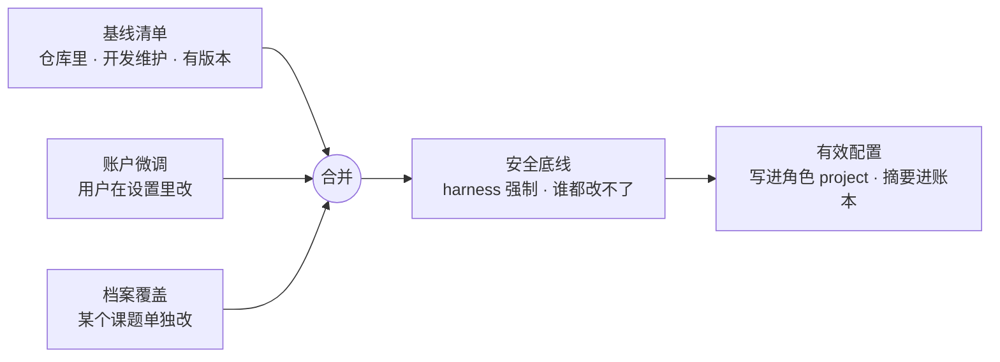
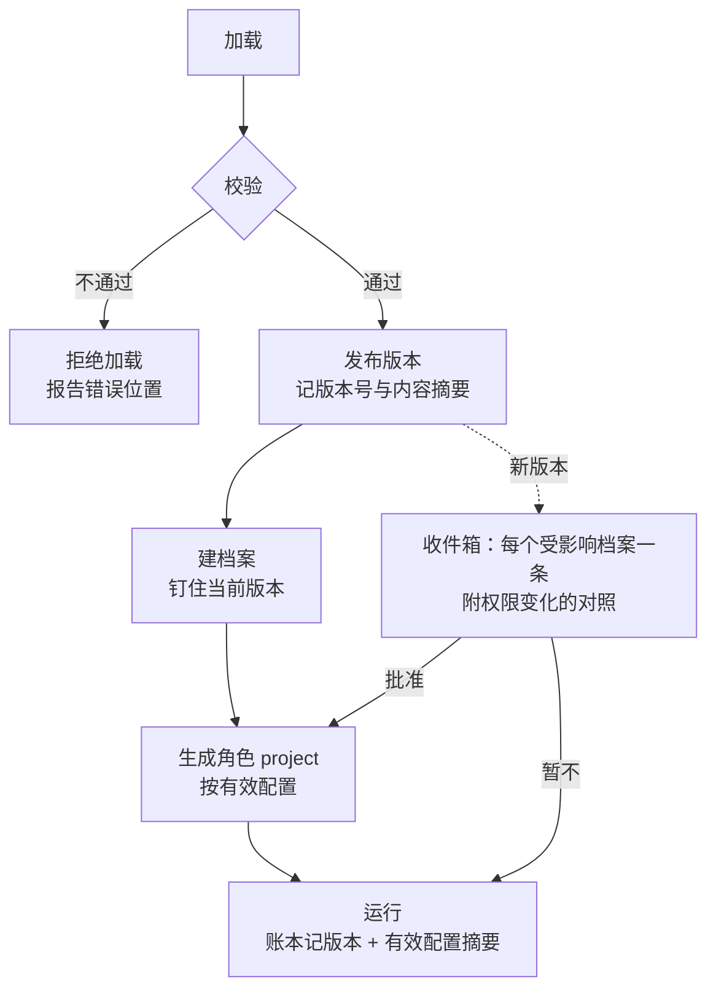

# 工作台 harness

- 日期：2026-10-20
- 状态：设计稿（用户已定 4 个关键问题）
- 关系：[ARCHITECTURE_BENCHES.md](ARCHITECTURE_BENCHES.md) 第 10 节的展开；实现遵守 [BACKEND_MEMORY_SESSION.md](BACKEND_MEMORY_SESSION.md)（记忆、委托、账本）和 T-ROLE 已验证的角色隔离

## 0. 已定

| 问题 | 决定 |
|---|---|
| 谁改清单 | **开发维护主体，用户可以微调。** 用户在界面里只能改允许微调的部分（模型位置、预算、把「询问」收紧成「禁止」），**不能放宽权限** |
| 清单升级 | **档案钉版本。** 新版上线后出现在「上线时待批准」收件箱，用户批准才升级 |
| 档案覆盖 | **可以覆盖，但只能收紧，或者换模型 / 预算。** 放宽工具权限要走审批卡，并记进账本 |
| 新工作台 | **留好扩展位。** 清单能描述一个新的台，前端先用通用壳跑起来 |

## 1. 它是什么

harness 是控制面里的一层：**读清单，把一个工作台「跑起来」。** 清单只描述配置，不写逻辑。

| harness 做 | harness 不做 |
|---|---|
| 校验清单，计算「有效配置」 | 业务逻辑（引用核对、出图、评分……这些在工具和适配器里） |
| 建档案目录，生成角色 project（复用 T-ROLE 的生成器） | 直接调用模型（模型一律走网关） |
| 发工具权限和 MCP 授权，按白名单 | 替用户做审批 |
| 运行门禁状态机，越级时拒绝（409） | 在运行中途改配置 |
| 校验委托的两端，登记产物 | |
| 把事件映射成前端卡片 | |
| 记账：每次运行写清单版本和有效配置摘要 | |

## 2. 四层叠加：基线 → 账户 → 档案 → 底线



**合并规则（核心）：**

| 字段 | 账户微调 / 档案覆盖可以怎么改 |
|---|---|
| 模型位置（`model_slot`） | 随便换，只要网关里有这个位置 |
| 预算 | 随便改，但不超过账户总上限 |
| 工具权限 | **只能收紧**：allow → ask → deny。放宽（deny → ask、ask → allow，或新增工具）= 生成一张审批卡，批准后作为「档案覆盖」写入，账本记一条 `harness.loosen` |
| `write_targets` | 只能是基线的子集；扩大同样走审批卡 |
| 记忆读写范围 | 只能收窄 |
| 门禁 | **不能改**：门禁属于工作台的规矩，不属于个人偏好 |
| 角色提示词 | 不能改基线；可以追加一段「档案说明」，作为角色 AGENTS.md 的附加段落 |

**安全底线（最后一层，任何配置都覆盖不了）：**
1. 每个角色的权限第一条是 `"*": "deny"`。
2. `task` 永远是 deny：子 agent 只由控制面调度。
3. 风险为 `danger` 的工具永远不能设成 allow，最多 ask，并且只能由用户本人点。
4. 写入只能落在本档案目录内；角色 project 本身不可写。
5. 配置里出现 `{file:` / `{env:` 引用，直接拒绝加载。
6. 模型调用只走网关临时 key；角色和引擎拿不到真实 key。
7. 预算硬上限：任何覆盖都不能超过账户上限。
8. 常驻自动化只观察和告警，对外动作只生成审批卡；交易类动作不存在可调用的工具。

**判定口诀：** 往「更安全」方向改，直接生效；往「更危险」方向改，要你批准；越过底线，谁批准都不行。

## 3. 清单长什么样

一份清单 = 一个工作台。放在仓库的 `benches/<id>.bench.yaml`，提示词放在 `prompts/<id>/`。schema 用 zod 定义，前后端共用。

```yaml
schema: reinlab.bench/v1
id: research
version: 1.3.0                  # 语义化版本；改权限至少升次版本号
code: RSCH
title: 研究工作台
ui: custom                      # custom：有专属前端 | generic：用通用壳（第 8 节）

dossier:
  layout: [papers/, notes/, swarm/, results/, study_plan/]
  templates: { notes/README.md: templates/research/notes-readme.md }

model_slots:                    # 本台用到的模型位置，映射到网关里的分档
  read: mid
  swarm_child: cheap
  review: strong

roles:
  read-assistant:
    prompt: prompts/research/read.md
    model_slot: read
    steps: 48
    tools:                      # 内核原生工具 + ReinLab 插件工具
      read: allow
      cite_check: allow
      write_layer: ask
      webfetch: ask
    mcp:                        # 本角色能用的 MCP 能力（MCP 能力层里注册过的）
      papers: [search, fetch]
      classroom: [scene]
    write_targets: [notes/]
    memory: { read: [L1, L2, L3], write: [L1] }
  swarm-critic:
    prompt: prompts/research/critic.md
    model_slot: review          # 独立审查建议用不同的模型
    tools: { read: allow, post_blackboard: allow }
    write_targets: [swarm/own-deliveries/]
    memory: { read: [L1, L2], write: [] }

gates:                          # 门禁：声明式状态机
  read:
    stages: [ingest, layers, qa, check, close]
    require:                    # 进下一段前必须存在的产物
      layers: [artifact:layer_card]
      close: [artifact:check_result]
    approve: user               # 门只能由用户放行

delegations:
  accepts: [research.brief]                  # 别的台可以发来的委托类型
  sends: [automation.adapt, curriculum.lesson]

cards:                          # 结构化卡片工具：生成插件工具 + 前端卡片
  layer_card:  { schema: schemas/layer-card.json, ui: LayerCard }
  check_card:  { schema: schemas/check-card.json, ui: CheckCard }

budget: { default_cny: 5, by_mode: { read: 5, swarm: 30 } }

tunable:                        # 用户在界面里能微调的字段（白名单）
  - model_slots.*
  - budget.*
  - roles.*.tools.*: tighten_only
```

## 4. 生命周期



1. **校验：** 加载时依次检查——
   - schema 是否合法；
   - 引用是否都存在：提示词文件、工具、MCP 能力、卡片 schema、委托类型；
   - 安全底线：例如出现 `"*": allow` 或 `task: allow`，直接拒绝加载；
   - 不变量：例如 `write_targets` 不能指向档案目录之外。
2. **发布：** 同一个版本号的内容一旦发布，不能再改。要改就升版本号。
3. **钉版本：** 档案记住 `bench@version`。账户微调和档案覆盖单独存，不改基线。
4. **生成角色 project：** 只在**两次运行之间**进行，绝不在运行中途改。生成结果的摘要写进账本，T-ROLE 的那套校验照常执行。
5. **升级：**
   - 新版本上线后，每个受影响的档案在「上线时待批准」里出现一条，附上前后对照。**权限放宽的部分用橙色标出**，收紧的部分用灰色。
   - 批准后，等当前运行结束再生成新的角色 project。
   - 不批准，就继续用旧版本，不打扰。
6. **回放与审计：** 任何一次运行，都能从账本里的「版本 + 有效配置摘要」还原出当时生效的完整配置。

## 5. 门禁、委托、卡片怎么从清单里长出来

- **门禁：** harness 按 `gates` 生成状态机，并在三处同时生效：
  - API：越级请求返回 409；
  - 工具钩子：门没开时，下一段的写工具一律拒绝；
  - 前端：页头常驻三道边界提示（课程台的「蓝图 ≠ 单元已创建 ≠ 可以开课」就是这样来的）。

  `approve: user` 的门，只有用户的界面操作能放行，Agent 发起的放行请求一律变成审批卡。
- **委托：**
  - 发起方的 `sends` 和接收方的 `accepts` 都要列了这种委托类型才能成立，harness 两头都校验。
  - 委托合同的格式沿用 BACKEND_MEMORY_SESSION 第 6 节。
- **卡片：**
  - 每个 `cards` 条目会生成一个结构化插件工具：模型必须按 schema 填写，不合法就拒收。
  - 卡片同时生成前端事件，由对应的卡片组件渲染。
  - 这就是「输出是我们的样子」的保证（BACKEND_MEMORY_SESSION 第 14.3 节）。

## 6. 用户在界面里能改什么

- **入口有两个：**
  - 设置里的「工作台偏好」：账户级；
  - 档案页的「本档案设置」：档案级。
- **只显示 `tunable` 列出的字段。** 每一项旁边标出它来自基线、账户还是档案。
- **收紧和换模型 / 预算：** 直接生效，从下一次运行开始。
- **放宽：** 按钮文字是「申请放宽」，点了生成审批卡。卡上写清楚放宽了什么、影响哪些角色、风险等级。批准后账本记一条 `harness.loosen`，档案页留一个可撤销的标记。

## 7. 存在哪里

| 东西 | 存放位置 |
|---|---|
| 基线清单、提示词、卡片 schema | 仓库（随代码评审、随部署发布） |
| 已发布版本的内容与摘要 | Supabase `bench_version` 表（只追加） |
| 账户微调 | `bench_tuning`（account_id, bench, patch） |
| 档案覆盖 | `dossier_override`（dossier_id, patch, 来源：tighten / approved_loosen） |
| 有效配置快照 | 按摘要去重存储；账本里只记摘要 |

所有表都启用 RLS + FORCE，与现有 20 张表同一套规则。

## 8. 扩展位：用清单长出新的工作台

`ui: generic` 的工作台不需要专属前端，由通用壳渲染：
- BenchFrame：面板切换、快门转场；
- AgentDock：对话、审批卡、计划；
- Explorer：档案目录。

清单里多一个 `faces` 段，只能从下面几种「通用面」里选：

| 通用面 | 内容 |
|---|---|
| `doc` | 档案文件的阅读与编辑，像研究台的笔记 |
| `pipeline` | 门禁流水线视图，按 `gates` 自动生成 |
| `runs` | 运行记录与逐步回放 |
| `board` | 实时面板栅格，复用自动化台的 LivePanel |
| `cards` | 卡片流，按 `cards` 渲染 |

**新增一个台的步骤：**
1. 写一份清单和提示词；
2. 需要新能力时，先在 MCP 能力层注册；
3. 选好通用面，上线。

以后要专属界面了，再把 `ui` 改成 `custom`。

## 9. 测试（给 Codex）

| 编号 | 内容 |
|---|---|
| T-HAR-1 | 清单里写 `"*": allow`、`task: allow`、danger 工具设成 allow、`write_targets` 越界、带 `{file:` 引用：每一种都拒绝加载，并指出出错位置 |
| T-HAR-2 | 合并规则：收紧直接生效；放宽不经批准时，有效配置不变，并生成一张审批卡；批准后生效，账本出现 `harness.loosen` |
| T-HAR-3 | 账户微调和档案覆盖不能超过账户预算上限 |
| T-HAR-4 | 钉版本：发布新版本不影响已有档案；批准升级后，等当前运行结束才重新生成角色 project，运行中途不变 |
| T-HAR-5 | 同一个版本号的内容不可改：改内容不升版本号，加载失败 |
| T-HAR-6 | 门禁：越级 API 返回 409；门没开时下一段的写工具被钩子拒绝；Agent 请求放行只会得到审批卡 |
| T-HAR-7 | 委托两端校验：任意一端没有声明这种委托类型，委托都无法成立 |
| T-HAR-8 | 卡片工具：不符合 schema 的输出被拒收，并保留拒收记录 |
| T-HAR-9 | 回放：从账本里的「版本 + 有效配置摘要」还原出的配置，和当时生成的角色 project 逐字节一致 |
| T-HAR-10 | T-ROLE-1～5 在 harness 生成的角色 project 上全部仍然通过 |

## 10. 落地顺序

1. **第三批（进行中）：** 研究台按 `research.bench.yaml` 实现，完成 T-HAR-1、2、5、10（见 CODEX_BRIEF_BATCH3_ADDENDUM）。
2. **研究台第一期结束前：** 钉版本与升级收件箱（T-HAR-4）、门禁（T-HAR-6）、卡片（T-HAR-8）、回放（T-HAR-9）。
3. **第二个台（建议工程台）：** 只写清单和少量工具，验证 harness 的通用性；完成委托校验（T-HAR-7）。
4. **通用壳：** 等有第一个 `ui: generic` 的新台需求时再做前端。

## 11. 还没定的小事（不影响第三批）

1. **用户微调的入口放在哪：** 放进设置页，还是每个工作台各自的设置面。
2. **升级对照的展示：** 收件箱里的前后对照，是直接展示 YAML diff，还是翻译成「放宽了什么 / 收紧了什么」的人话。建议人话为主，YAML 可以展开查看。
3. **提示词的版本：** 提示词改动是否也触发清单升版本号。建议触发：提示词变了，行为就变了。
