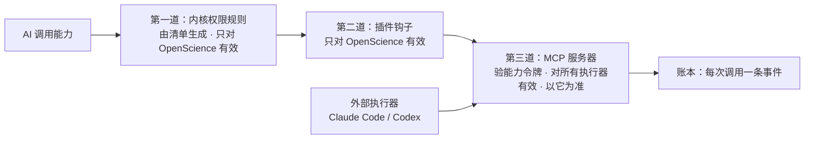

# MCP 能力层

- 日期：2026-10-23
- 状态：设计稿（用户已定 4 个关键问题）
- 关系：
  - 上接 [HARNESS.md](HARNESS.md)：清单里的 `tools` 和 `mcp` 段指向这里登记的能力；
  - 下接 Codex 第四批 P1-11（卡片工具、记忆工具、权限钩子）；
  - 遵守 [ARCHITECTURE_BENCHES.md](ARCHITECTURE_BENCHES.md) 第 11.4 节的「三条通道」：AI 只能通过 MCP 或插件工具调用能力。

## 0. 已定

| 问题 | 决定 |
|---|---|
| 跑在哪 | **混合。** 会接触用户文件或用户数据的，跑在各人的账户容器里；只做生成、不存状态的，共享部署，靠运行令牌隔离 |
| 社区 MCP | **只用审过的白名单。** 只接官方或审查过的，锁定版本，放在沙盒里跑；新增一个要走审查 |
| 外部执行器 | **用同一套。** 以后在容器里跑的 Claude Code / Codex 用同一套 MCP，权限同样由清单下发 |
| 第一批能力 | 记忆（读 / 提议升级）、卡片与审批、论文检索与获取、档案文件读写 |

## 1. 一句话

**每一项 AI 可调用的能力，都登记在一张能力表里，并以 MCP 服务器的形式提供。授权的最终判定在服务器端，依据每次运行签发的能力令牌。**

为什么判定必须放在服务器端：内核里的 ReinLab 插件钩子只管得到 OpenScience。以后接入的 Claude Code、Codex 执行器没有我们的插件，只有服务器端的检查对所有调用方都有效。所以采用**三道关、以最后一道为准**：

## 2. 能力表（registry）

现有的 `tools/registry.json` 扩展成能力表，每一项写清：

| 字段 | 含义 |
|---|---|
| `server` / `capability` | 例如 `papers` / `search`，调用名为 `papers.search` |
| `placement` | `account`（账户容器内）、`control`（控制面）、`shared`（共享引擎）、`external`（白名单社区 MCP） |
| `risk` | `read`、`write`、`danger`，与 harness 安全底线配合 |
| `effects` | `none`、`dossier_write`、`memory_proposal`、`ui_card`、`network_fetch`：给审批卡和账本用 |
| `input` / `output` | JSON schema；输出不合法时由服务器拒收 |
| `idempotent` | 是否要求调用方提供请求编号（写类能力一律要求） |
| `egress` | 允许访问的外部域名（只有需要联网的能力才填） |
| `availability` | `implemented` / `planned`；`planned` 的能力在清单里可以出现，但调用时一律返回「未实现」，不假装成功 |
| `review` | 外部 MCP 的审查记录：来源、许可证、锁定的版本与摘要、审查日期 |

清单里的 `tools` 和 `mcp` 两段，都必须引用能力表里的条目，这一点 harness 已经在校验（T-HAR-1）。

## 3. 能力令牌

每次运行开始时，控制面签发一张**短期能力令牌**，注入给这次运行用到的全部 MCP 客户端（内核或外部执行器都一样）。

| 声明 | 内容 |
|---|---|
| 身份 | `account`、`dossier`、`run`、`role`、`bench@version`、有效配置摘要 |
| 能力 | 允许的 `server.capability` 列表，每项带 `allow` / `ask` |
| 范围 | `write_targets`、记忆读写层级、引用白名单（例如显式传入的 memoryRefs） |
| 预算 | 本次运行的预算 hold 编号（有付费外部调用时用） |
| 期限 | 运行结束，或最长 2 小时，先到为准；控制面可以随时吊销 |

**服务器每次调用都检查：**
1. 签名是否有效、令牌是否过期或被吊销；
2. 这项能力是否在令牌的允许列表里；
3. 参数是否在范围内（路径在 `write_targets` 里、记忆层级被允许……）；
4. 能力是 `ask` 时，有没有一个已批准的审批编号（第 4 节）。

任何一项不满足就拒绝，并写一条拒绝事件进账本。

令牌只在进程内存和临时运行配置里，**不写进角色 project、不写日志、不进证据**。这一条沿用这次凭据事件的教训：令牌也是凭据。

## 4. 需要批准的能力（ask）怎么走

内核和外部执行器走同一套流程：

1. AI 调用一项 `ask` 能力，但没带审批编号 → 服务器返回 `APPROVAL_REQUIRED`，附带控制面新建的 `approvalId`；
2. 控制面推一张审批卡给用户（说明做什么、影响什么、风险等级）；
3. 用户批准 → 控制面把这个 `approvalId` 标记为「已批准、只能用一次、只对这次调用的参数摘要有效」；
4. AI 带着 `approvalId` 重新调用 → 服务器向控制面核对：已批准、参数摘要一致、还没用过 → 执行，并标记为已使用。

对内核的优化：P1-10 已经接好了 OpenScience 自己的「询问」流程。这条路上批准时，控制面同时签发同一种 `approvalId`，插件钩子把它带进 MCP 调用，避免用户被问两次。

**不变式：**
- 没有人点批准，`ask` 能力就绝不执行；
- 一次批准只放行一次调用，参数改了要重新批准；
- `danger` 能力最多只能是 `ask`，并且只能由用户本人点。

## 5. 放在哪：第一批四个服务器

| 服务器 | 放在哪 | 能力 | 说明 |
|---|---|---|---|
| `files` | 账户容器（stdio） | `list`、`read`、`write`、`patch` | 取代内核原生的写和编辑工具。第一批里原生写入工具一律拒绝，多文件补丁也由这里提供（就是 P1-10 留下的「多文件补丁先拒绝」那一项） |
| `memory` | 账户容器（stdio，代理到控制面的记忆 API） | `read`、`propose` | 读取范围按清单和 Q-060 的规则；`propose` 只生成「上线时待批准」的条目，绝不直接写入 L3 / L4 |
| `cards` | 控制面（HTTP） | `card.<name>`、`approval.request`、`gate.request_open` | 卡片 schema 来自清单的 `cards` 段；门禁只能由用户放行，AI 只能请求 |
| `papers` | 共享（HTTP） | `search`、`fetch`、`pages` | OpenAlex / arXiv / Unpaywall；只取开放获取全文；联网只放行这几个域名 |

**`files` 的规则**（复用 P1-10 插件里已经验证过的检查）：
- 路径一律先取真实路径，必须在本档案目录内；
- 写入必须落在 `write_targets` 内；
- 拒绝符号链接、多硬链接文件、特殊文件；
- 单个文件和单次补丁都有大小上限；
- 每次写入前先保存旧版本，可以一键撤销；
- 写类能力默认是 `ask`，除非清单明确给了 `allow`。

**`papers.fetch` 的规则：**
- 拿到的论文由**控制面**写进档案的 `papers/`。`papers` 服务器本身不碰用户文件，所以它可以共享部署；
- 每篇都记录来源、许可证、是否开放获取；
- 拿不到全文就标 `abstract_only`，不冒充全文（对应规格 P2-02）。

**`papers.pages` 的规则：**
- 按页返回文本，并附页码锚点，给引用核对用；
- 第一批用 PDF 文本层；GROBID 等更好的解析以后再换，接口不变。

## 6. 现有工具名怎么对应

研究台清单里已经用了一批计划中的工具名。第一批按下表落到能力上，清单不用改名，由能力表做映射：

| 清单里的工具名 | 对应的能力 |
|---|---|
| `literature` | `papers.search` / `papers.fetch` / `papers.pages` |
| `memory_read` | `memory.read` |
| `memory_propose` | `memory.propose` |
| `card_answer`、`card_approval` | `cards.card.answer`、`cards.approval.request` |
| `finding_record` | `cards.card.finding`（发现卡），附带 `files.write` 到 `findings/` |
| `read_layer_write`、`read_quiz_write` | `cards.card.layer`、`cards.card.quiz`，内容写到 `read/layers/`、`read/quizzes/` |
| `plan_propose` | `cards.approval.request`（自研计划），批准后才落文件 |

## 7. 外部 MCP 白名单

- **进白名单的条件：**
  1. 官方出品或来源清楚，许可证允许这样使用；
  2. 锁定版本和摘要；
  3. 审查方读过它会访问什么、会写什么；
  4. 在能力表里逐个登记它的工具和风险等级。
- **运行方式：**
  - 放在独立沙盒容器里，**挂不到账户卷**，需要的文件由 `files` 能力转交；
  - 联网只放行它需要的域名；
  - 凭据（比如 GitHub token）由控制面在运行时注入，不进清单。
- **候选**（等工程台接后端时再审）：微软的 Playwright MCP、GitHub 官方 MCP。第一批**不接**任何外部 MCP。

## 8. 外部执行器

以后在账户容器里跑 Claude Code / Codex 时：
1. 控制面按同一份有效配置，生成执行器的 MCP 配置文件（例如 `.mcp.json`），内容只有这次运行允许的服务器；
2. 能力令牌注入到执行器进程的环境里，只对这个进程可见，**不写进 shell 配置**；
3. 执行器没有我们的插件钩子，所以服务器端的令牌检查就是它唯一的边界。这也是第 1 节把服务器端定为最终判定的原因。

## 9. 账本与费用

- **每次调用一条事件** `capability.call`，内容包括：服务器、能力、参数摘要、结果摘要、风险、`approvalId`、耗时、成败。参数和结果都只记摘要；大的输出存为产物，事件里只放引用。
- **拒绝也记账**（`capability.denied`），并附原因：没在令牌里、超出范围、缺少批准、令牌过期……
- **写类调用按请求编号去重**：同一编号、同样内容，返回原结果；同一编号、不同内容，返回 409。沿用 P1-10 的幂等语义。
- **付费外部调用：** 第一批没有。以后有了，先从这次运行的预算 hold 里预留。

## 10. 测试（给 Codex 第四批）

| 编号 | 内容 |
|---|---|
| T-MCP-1 | 不带令牌、令牌过期、令牌被吊销、签名被篡改：每一种都被拒绝，并且账本里有拒绝事件 |
| T-MCP-2 | 能力不在令牌里的调用被拒绝，**包括外部客户端直接连服务器的情况**（模拟一个没有插件的执行器） |
| T-MCP-3 | `ask` 能力：没批准不执行；批准后只放行一次；参数改了要重新批准；同一个 `approvalId` 重放被拒 |
| T-MCP-4 | `files`：越出档案目录、越出 `write_targets`、符号链接、硬链接、特殊文件都被拒；撤销能恢复旧版本；多文件补丁要么全成、要么全不成 |
| T-MCP-5 | `memory.read` 只返回清单允许的层级，并遵守 Q-060；`memory.propose` 只生成收件箱条目，L3 / L4 不变 |
| T-MCP-6 | `cards`：不符合清单 schema 的卡片被拒收；`gate.request_open` 只生成审批卡，门禁状态不变 |
| T-MCP-7 | `papers`：只能访问白名单域名；拿不到开放获取全文时标 `abstract_only`；页码锚点和原 PDF 页码一致 |
| T-MCP-8 | 写类调用按请求编号幂等：同内容返回原结果，异内容 409 |
| T-MCP-9 | 令牌、key 不出现在任何日志、证据、角色 project、shell 环境快照里（用值扫描证明，只数命中次数） |
| T-MCP-10 | 用真实 OpenScience 内核端到端：研究角色调用 `papers.search` → `files.write`（经过批准）→ `cards.card.finding`，账本完整，前端收到卡片事件 |

## 11. 落地顺序

1. **第四批（P1-11）：**
   - 能力表扩展；
   - 能力令牌的签发、校验与吊销；
   - `files`、`memory`、`cards` 三个服务器；
   - 插件钩子改成「带上审批编号」；
   - 完成 T-MCP-1～6、8、9。
2. **第四批末或第五批：** `papers` 服务器（T-MCP-7），以及端到端验证（T-MCP-10）。它和研究台第二期「精读」直接相关，可以和 P2-02 合并。
3. **以后：**
   - 接工程台时审 Playwright MCP 和 GitHub MCP；
   - 接会员时，外部执行器的 MCP 配置生成和令牌注入照第 8 节做。

## 12. 还没定的小事（不阻塞第四批）

1. **令牌格式：** 自己签的 JWT（Ed25519），还是直接复用 Supabase 签发的 JWT 加自定义声明。建议自签：令牌的声明比登录 JWT 复杂得多，而且要能单独吊销。
2. **`files` 撤销：** 旧版本保留多久。建议按档案保留最近 50 个版本，档案快照里也带上。
3. **共享 `papers` 的缓存：** 公开论文的缓存能不能跨账户复用。建议可以复用，因为是公开数据；但每个账户「谁取了哪篇」照样各自记账。
