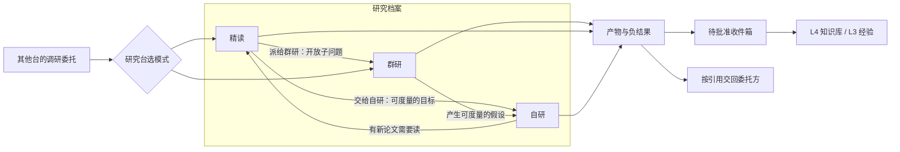

# PRD · 研究台 RSCH（后端与端到端）

版本 1.0 · 2026-10-19 · 状态：待评审

**关联文档：**
- [BACKEND_SYSTEM.md](BACKEND_SYSTEM.md)（系统总览与部署）
- [BACKEND_MEMORY_SESSION.md](BACKEND_MEMORY_SESSION.md)（记忆、会话、翻译层）
- [WORKBENCH_SPEC.md](WORKBENCH_SPEC.md) 第四节（前端规格）
- [CODEX_SPEC_RESEARCH.md](CODEX_SPEC_RESEARCH.md)（给 Codex 的实现规格）
- [ACCEPTANCE_RESEARCH.md](ACCEPTANCE_RESEARCH.md)（最终交付检测，验收方：Claude）

---

## 1. 背景与目标

研究台是 ReinLab 的第一条真实链路。它有两个身份：

1. **你自己的研究工具。** 三种模式：
   - **精读**：搞懂一篇论文。
   - **群研**：几十个 agent 攻一个开放问题，并且看得见它们怎么通信。
   - **自研**：对一个可度量的目标自动迭代。
2. **其他工作台的「调研服务」。** 课程台的学习方法调研、探索台的景点与机位调研，都通过委托交给研究台。

所以研究台同时用来验证整个底座：账本、门禁、记忆分层、委托、翻译层、模型路由。

**目标：** 10 周内交付三种模式的第一版，并接住一次真实的跨台委托（第 12 节的四条成功标准）。

## 2. 用户与场景

**用户：** 你本人和少量朋友（第一年 < 20 人），每人一个账户，账户之间完全隔离。

| 场景 | 模式 | 一句话 |
|---|---|---|
| 搞懂一篇 arXiv 论文 | 精读 | 分层解析、每条说法都能回到原文页码、互动动画、理解检查；有代码就提议小规模复现 |
| 证明 / 数学概念 | 精读 → 群研 | 先读懂一篇论文，再把开放子问题派给群研 |
| 开放问题调研 | 群研 | 例如「长上下文检索有哪些可行路线」：拆解 → 广搜 → 精读 → 反驳 → 核实 → 带出处的报告 |
| 优化一个数字 | 自研 | 例如「这批扫描 PDF 的 OCR 识别率提到 98%」「这个文件夹图片的分类准确率」「这份 Excel 的预测误差」 |
| 被别的台委托 | 自动选模式 | 课程台：「群论自学的方法与路线」；探索台：「东山秋季人像机位」 |

## 3. 范围

**第一版要做：**
- 三种模式。群研是精简版：8–12 个 agent，上限 32。
- 统一的研究档案、模式之间一键派发。
- 预算门禁、审批卡、账本与回放。
- 升级提议进入「待批准收件箱」。
- 统一的「调研委托」接口，先接课程台。

**第一版不做：**
- 多人协作同一个研究档案。
- 群研「从任意时刻分叉重跑」。
- 自建 GPU。
- 中文付费数据库（如知网）的自动抓取：只支持用户上传。
- 探索台的委托模板：接口是通的，但第一版只验证课程台。

## 4. 已确定的决策

| 主题 | 决定 |
|---|---|
| 范围 | 三种模式都做，群研先做精简版 |
| 领域 | AI / ML 论文、数学、通用调研、自然科学 |
| 自研算力 | 账户容器里跑 CPU；需要 GPU 时发到 Modal |
| 检索源 | 开放获取（OpenAlex / arXiv / Semantic Scholar）+ 用户上传 PDF + 付费网页搜索 + 中文来源（可达性与合规逐一核实） |
| 群研通信 | 黑板 + 少量点对点（提问 / 反驳 / 转交）；7 种消息都是真实的工具调用 |
| 群研规模 | 按预算自动提议（精简版 8–12，上限 32），你确认后开始，可改 |
| 群研模型 | 按角色分档：搜索 / 阅读用便宜模型；指挥 / 反驳 / 核实 / 汇总用强模型；反驳与核实尽量用和被审对象不同家的模型 |
| 回放 | 消息、黑板、任务状态可拖动回放；点开可看单个 agent 的完整过程 |
| 解释动画 | **交给 OpenMAIC 的互动内容生产线**，在隔离的 iframe 里渲染；3D 组件放开（仅限 iframe 内） |
| 复现 | 有代码就提议小规模试跑，你批准后再跑 |
| 沉淀（都要你批准） | 读过的论文与批注、核实过的结论、负结果、自研经验 |
| 委托 | 统一的「调研委托」格式 + 各台自己的产出模板；研究台内部决定用哪种模式 |
| 默认预算 | 精读 ¥5、群研 ¥30、自研按实验单独定；会员额度与 GPU 算力单独计 |
| 交付 | 三期，共约 10 周 |

## 5. 复用盘点：什么现成、什么要补

| 能力 | OpenScience 现状 | 我们要做的 |
|---|---|---|
| 文献检索与全文读取 | `literature` 工具：OpenAlex + arXiv 联合检索、去重；全文按页抽取；arXiv 限流冷却 | 加用户上传与付费网页搜索的凭据路由；中文来源走网页搜索 |
| 复现流程 | 有复现指南与计算任务（本机 / SSH / Modal） | 把「pilot 提议 → 批准 → 运行 → 判定」接到我们的门禁与审批卡 |
| 自研循环 | **Autoresearch 基本现成**：study、基线、想法队列、保留 / 回滚判定、lessons、steer 指令、预算暂停、写报告；落盘 `study.md` / `ideas.md` / `results.tsv` / `lessons.md` | 研究简报对话（question / hypothesis / metric / scope / budget / compute）、前沿曲线视图、经验升级提议、数据集上传 |
| 子 agent | 指挥派发 worker（explore + 专科），worker 运行时不往外吐事件，只交最终结果，**worker 之间不通信** | **群研的黑板、点对点消息、编制、回放全部要补**（第 7.3 节） |
| 计划模式、提问、权限 | `/plan`、live decision、permission 规则 | 由翻译层转成我们的审批卡与回答卡 |
| 互动动画 | — | 调 OpenMAIC 互动内容生产线（第 7.2.4 节） |

## 6. 用户流程总览



- 每个研究档案下可以同时有三种模式的运行。
- 派发是一次**同档案内**的交接：带上任务说明和引用，进入目标模式的收件箱。这和前端的「一键串联」一致。

---

## 7. 功能需求

### 7.1 通用

| 编号 | 需求 | 验收 |
|---|---|---|
| G1 | 研究档案：一个研究课题一个档案，对应一个 OpenScience project 目录 | 档案之间文件与会话互不可见（账户内、账户间都是） |
| G2 | 每次运行开始前给出**费用预估**和默认预算（精读 ¥5 / 群研 ¥30 / 自研按实验）。你可以改，确认后才开始 | 预估显示 ¥、会员额度、GPU 分钟三栏 |
| G3 | 预算门禁：用到 80% 提醒；到 100% **停下**，等你决定加预算、下结论或终止 | 停下时不丢状态，可以继续 |
| G4 | 写入、对外付费、计算任务都走审批卡；危险动作（删档案等）只能你点 | 页面、聊天、接口三条路走同一判断 |
| G5 | 账本：每个工具调用、消息、判定、费用都记事件；可导出审计并重放顺序 | 重放的顺序与费用合计和原运行一致 |
| G6 | 模式间一键派发：带上任务说明与引用，进入目标模式的收件箱，不自动开始 | 派发后目标模式的收件箱出现一条待办 |
| G7 | 升级提议：运行收尾时，可沉淀的内容生成升级请求，进入上线时弹出的收件箱 | 不批准就不进 L3 / L4 |
| G8 | 断线恢复：客户端断开后，按快照 + 游标续读；进程崩溃后由 Hatchet 恢复长流程，**不重放已执行的外部副作用** | 重启账户容器后，进行中的群研能从最后一个检查点继续 |

### 7.2 精读 READ

#### 7.2.1 输入与获取

| 编号 | 需求 |
|---|---|
| R1 | 输入：arXiv id、DOI、URL、论文标题，或上传 PDF |
| R2 | 获取全文：先走开放获取（OpenScience `literature`）；拿不到就明确标出「只有摘要」，并请你上传。**不尝试绕过付费墙** |
| R3 | 全文按页抽取并缓存在档案里；之后所有引用都指向「文件 + 页码（+ 段落）」 |

#### 7.2.2 分层解析

| 编号 | 需求 | 验收 |
|---|---|---|
| R4 | 按层生成解析：一句话结论 → 问题与动机 → 方法 → 关键公式 / 定理 → 实验与证据 → 局限与开放问题 | 每层每条说法都带页码引用；没有引用的说法要标为「解读」 |
| R5 | 区分「作者声称」与「助手的解读」，数值类说法必须有引用 | 抽查 10 条数值说法，10 条都能回到原文页码 |
| R6 | 带定位的问答：从某一层、某段原文发起提问，会话带上位置；回答同样给出处 | — |

#### 7.2.3 理解检查

| 编号 | 需求 |
|---|---|
| R7 | 每层生成 1–2 道检查题（概念辨析、推导一步、反例），作答后才给解释 |
| R8 | 检查结果写进本档案（L2），收尾时与批注一起提议升级进知识库 |

#### 7.2.4 互动解释动画（OpenMAIC）

| 编号 | 需求 | 验收 |
|---|---|---|
| R9 | 选中一个概念或一段方法，点「生成互动解释」，向 OpenMAIC 互动内容生产线发请求：概念、论文上下文（引用片段）、希望的组件类型（模拟 / 图解 / 代码 / 小游戏 / 3D 可视化 / 操作技能） | 返回 OpenMAIC 的 `InteractiveContent`（完整 HTML 文档 + 组件类型） |
| R10 | 渲染：iframe `srcDoc` + `sandbox="allow-scripts"`（**不给** same-origin、表单、弹窗、顶层跳转），并设置严格 CSP，只允许 OpenMAIC 已知的 CDN | 组件无法读取 ReinLab 的 cookie、存储或父页面 |
| R11 | 每个动画都是一个产物（有版本）。你确认「讲对了」后才挂到解析层上；之后课程台的「课堂」也可以复用 | 讲错可以驳回并说明原因，原因作为再生成的输入 |
| R12 | 降级：生成失败或渲染异常时，降级为静态图解加文字说明，不阻塞精读 | — |

> **待核实：** 你的 OpenMAIC 部署是否提供「只生成一个互动场景」的接口。如果只能整课生成，需要在 OpenMAIC 侧加一个端点（上游 PR 或我们的适配服务）。这是第 2 期开工前的第一件事。

#### 7.2.5 复现

| 编号 | 需求 | 验收 |
|---|---|---|
| R13 | 检测到论文有官方代码仓库时，提议一次小规模试跑。提议里列出：代码版本、数据、模型权重是否可得、预计算力与费用、与原文设置的差异 | 你批准后才执行 |
| R14 | 执行走 OpenScience 计算任务：CPU 在账户容器，GPU 发到 Modal | — |
| R15 | 结果判定三选一：**完全复现 / 部分复现 / 未解决**，附差异说明与全部失败尝试；**禁止**为凑原文数字反复改方法 | 判定与证据文件一起保存为产物 |

#### 7.2.6 派发

| 编号 | 需求 |
|---|---|
| R16 | 「派给群研」：把开放问题连同已读论文的引用交过去 |
| R17 | 「交给自研」：把可度量的改进想法连同代码引用交过去 |

### 7.3 群研 SWARM（要补的核心）

#### 7.3.1 角色

沿用前端的 8 种角色。

| 角色 | 职责 | 默认模型档 |
|---|---|---|
| 总负责人 lead | 定问题边界、发布任务、做决定、决定何时结束 | 强 |
| 拆解 planner | 把问题拆成子问题与任务 | 强 |
| 搜索 scout | 找来源，交「候选 + 理由」 | 便宜 |
| 阅读 reader | 读全文，交「带页码的摘要」 | 便宜 |
| 分析 analyst | 综合多篇，提出结论草稿 | 中 |
| 反驳 critic | 质疑结论，必须附理由 | 强（与被审对象不同家） |
| 核实 verifier | 回到原文核对引用与数值 | 强（与被审对象不同家） |
| 汇总 synth | 写报告 | 强 |

#### 7.3.2 编制

| 编号 | 需求 | 验收 |
|---|---|---|
| S1 | 开始前，总负责人根据问题大小和预算提议编制：人数、角色配比、模型档、预计费用与时长。精简版 8–12 人，上限 32 | 你确认或修改后才启动 |
| S2 | 运行中，总负责人可以申请加人，走审批卡；不能自行扩编 | — |

#### 7.3.3 通信：黑板 + 少量点对点

- **黑板**是一个共享的结构化空间，分四栏：问题、发现、求助、决定。任务板单独一块（状态：开放、进行中、完成、失败、降级为局限）。
- **7 种消息都是工具调用**，由我们的插件提供，后端存在控制面的「群研服务」里：

| 工具 | 消息 | 语义 |
|---|---|---|
| `swarm.broadcast` | 广播 | 一对所有：发布任务、公告决定（只有总负责人和拆解能发） |
| `swarm.claim` | 领取 | 认领开放任务；同一任务只能被一人领取（服务端原子操作） |
| `swarm.ask` | 提问 | 点对点要一条具体信息；提问方挂起，等「交付」后被唤醒 |
| `swarm.deliver` | 交付 | 交出结果；对应任务前进一格；必须附引用 |
| `swarm.help` | 求助 | 发到黑板「求助」栏，谁能帮谁接 |
| `swarm.handoff` | 转交 | 把半成品交给下一棒（搜索 → 阅读 → 核实） |
| `swarm.refute` | 反驳 | 质疑某个结论并附理由；被反驳的结论**要么补证据，要么降级为「局限」** |

另有只读工具 `swarm.board`（读黑板、任务板、收件），按角色过滤。

**规则：**
- 任何结论进入最终报告前，必须有核实者签核：引用存在、页码正确、数值一致。
- 「没找到」作为负结果交付，不能静默放弃任务。
- 每个 agent 只能看到黑板，以及发给它的点对点消息；看不到别人的上下文。

#### 7.3.4 在 OpenScience 上怎么跑

- **总负责人**是一个 OpenScience 会话。**其余 agent** 都是隔离工作区的子会话，各自用翻译层生成的 agent 定义（角色提示词、模型、工具白名单）。
- 子会话由**控制面调度**，不由总负责人直接派发。原因是 OpenScience 的 worker 运行中不吐事件，我们需要逐条事件。控制面通过 SDK 开子会话，并订阅每个子会话的事件流。
- **挂起与唤醒：**
  - `swarm.ask` 让提问方的本轮结束，状态记为「等待」。
  - 交付到达时，控制面经 Hatchet 发信号，给提问方开新的一轮，把交付内容作为输入。
  - 同样的机制用于「被反驳后补证据」。
- **并发**由控制面的准入限制控制（例如同时最多 8 个活跃 agent），超出的排队并在黑板上显示。

#### 7.3.5 终止与产出

| 编号 | 需求 |
|---|---|
| S3 | 结束条件，任一满足即止：总负责人宣布结束（所有子问题完成或降级为局限）、预算用完（停在门禁上等你）、你手动结束 |
| S4 | 产出报告：结论（每条附出处与核实签核）、分歧与反驳记录、局限、负结果、来源表（`sources.csv`）、参考文献 |

#### 7.3.6 回放

| 编号 | 需求 | 验收 |
|---|---|---|
| S5 | 时间线拖动到任一时刻，重建当时的全局：每个 agent 的状态、任务板、黑板、在途消息 | 回放只读账本，不调模型 |
| S6 | 点开任意 agent，看它的完整过程（输入、思考摘要、工具调用、输出），按需从账本加载 | — |

### 7.4 自研 AUTO

| 编号 | 需求 | 验收 |
|---|---|---|
| A1 | 研究简报：多轮对话 + 回答卡，填齐问题、假设、指标（含方向与计算方式）、范围（能改哪些文件 / 参数）、预算、算力 | 简报保存为 `program.md` 与 OpenScience study 配置 |
| A2 | **指标必须可计算。** 没有标注数据时（例如 OCR 识别率），先提议「抽样标注」：抽 N 页让你标正确文本，作为评估集 | 没有评估集就不开始 |
| A3 | 数据上传：PDF 文件夹、图片文件夹、Excel / CSV，进入档案工作区 | — |
| A4 | 运行复用 OpenScience Autoresearch：基线 → 想法队列 → 每个想法一次运行 → 保留或回滚判定 → lessons；steer 指令常驻 | 前沿曲线、运行矩阵、想法队列都来自账本与 `results.tsv` |
| A5 | 算力：默认账户容器的 CPU；想法需要 GPU 时提议用 Modal，经审批 | — |
| A6 | 预算门禁：沿用 OpenScience「预算到了就暂停、要求下结论」，并接到我们的门禁与审批卡 | — |
| A7 | 写报告：最优配置、关键消融、证据运行；lessons 生成升级提议 | — |

**OCR 例子（验收用）：**
- 输入：一个扫描 PDF 文件夹，目标「字符准确率 ≥ 98%」，预算 ¥X。
- 过程：抽样标注 20 页作为评估集 → 基线（例如 Tesseract 默认参数）→ 想法依次尝试：预处理（去噪、二值化、纠偏）、语言包、引擎切换、版面分析、大模型校对。
- 结束：达到目标，或预算用完时给出最优配置与 lessons。

### 7.5 调研委托接口

| 编号 | 需求 |
|---|---|
| D1 | 入参统一为 `research_request@1`（附录 A）：问题、范围、可读引用、预算、期望产出模板、截止时间 |
| D2 | 研究台内部选模式：有明确文献对象就用精读；开放问题用群研；可度量目标用自研。选择理由写进账本 |
| D3 | 产出按委托方模板交回：课程台用 `research_findings@1`（方法 / 路线 / 负结果），探索台用 `spots@1`（第一版只定义，不验收） |
| D4 | 负结果按 schema 交回；预算从委托方划拨；两边账本各记一条 |
| D5 | 委托方只批准了调研，研究台就只做调研，不做后续 |

---

## 8. 角色、权限与记忆

| 角色 | 可读（L1–L4） | 可写 | 工具白名单（风险） |
|---|---|---|---|
| 精读助手 | 本档案全部；L4 中已读论文 | 解析层、批注、检查题（L2） | 文献（读）、计算任务（写，需批准）、OpenMAIC 生成（写，需批准） |
| 群研总负责人 | 本档案、黑板全部 | 决定、任务板 | `swarm.*`、文献（读） |
| 群研其他角色 | 黑板（按角色过滤）、发给自己的消息、委托交给它的引用 | 自己的交付、黑板条目 | `swarm.*` 中本角色允许的部分、文献（读）、网页搜索（付费，计预算） |
| 核实者 | 被核实的结论及其引用的原文 | 签核 | 文献（读）；**不能**写结论 |
| 自研 | 本档案、数据集 | 实验分支、`results.tsv`、lessons | 计算任务（写）、study 工具 |

**升级提议（都进收件箱）：**
- 论文与批注、核实过的结论 → L4 知识库。
- 负结果 → L4（标注「负结果」）。
- 自研 lessons → L3 规程记忆，注明适用场景与证据运行。

## 9. 模型路由默认（每个位置可在设置里改）

| 位置 | 默认档 | 说明 |
|---|---|---|
| 精读解析、群研总负责人 / 拆解 / 汇总 | 强 | — |
| 搜索、阅读 | 便宜、快 | 批量 |
| 反驳、核实 | 强，与被审对象不同家 | 降低同源偏差 |
| 自研提想法与判定 | 强 | 沿用 OpenScience |
| 检查题、问答 | 中 | — |
| 嵌入 | 嵌入模型 | 知识库检索 |
| 互动动画 | OpenMAIC 自己的生成配置 | 计费单独统计 |

会员计划（ChatGPT / Codex、Copilot 等）只用本人登录、本人运行；条款不允许的那家只提供 API 方式（见系统文档）。

## 10. 非功能需求

| 类别 | 要求 |
|---|---|
| 速度 | 精读：开放获取论文 2 分钟内出第一层，10 分钟内出全部层与至少一个动画。群研：编制提议 1 分钟内。界面打开秒开（控制面直出） |
| 可靠 | 长流程（群研、自研、复现）由 Hatchet 编排，可断点续跑；已执行的外部副作用不重放；审批的「待决定」由我们持久化（OpenScience 崩溃后不会自己重建它） |
| 安全 | 账户隔离（容器 + RLS + 对象存储前缀）；OpenMAIC 组件在沙盒 iframe；上传文件只在本账户；凭据只注入本账户容器 |
| 成本准确 | 每个事件记录凭据类型与费用。¥、额度、GPU 分钟分开，与提供方账单的误差 < 5% |
| 可观测 | 每次运行有时间线、费用、失败原因；群研有活跃 agent 数、排队数、消息速率 |

## 11. 里程碑（三期，约 10 周）

| 期 | 时长 | 交付 | 出口标准 |
|---|---|---|---|
| 1 · 底座 + 自研 | 3 周 | 控制面骨架（档案、账本、门禁、预算、审批卡）、翻译层第一版、Fly + Supabase 环境、Autoresearch 接通、数据上传、研究简报、前沿曲线视图 | **自研跑通 OCR 例子** |
| 2 · 精读 | 3 周 | 文献获取与上传、分层解析与页码引用、检查题、带定位问答、OpenMAIC 互动动画（含沙盒与降级）、复现的提议与判定、升级提议与收件箱 | **精读一篇 arXiv 论文**达标 |
| 3 · 群研 + 委托 | 4 周 | 群研服务（黑板、7 种消息工具、编制、挂起与唤醒、准入）、回放、报告；`research_request@1` 与 `research_findings@1`；课程台接入 | **一次端到端群研**达标；**接住课程台的一次调研委托** |

## 12. 成功标准

1. **精读一篇 arXiv 论文：**
   - 10 分钟内出全部解析层和至少一个互动动画；
   - 抽查 10 条数值说法，都能回到原文页码；
   - 动画在沙盒内正常运行。
2. **一次端到端的群研：**
   - 对一个开放问题交出报告，每条结论都有出处和核实签核；
   - 通信可以拖动回放；
   - 费用在 ¥30 默认预算内，或按你的批准追加。
3. **自研跑通 OCR 例子：**
   - 有评估集；
   - 自动迭代，直到达到目标或预算用完；
   - 交出最优配置、运行矩阵和 lessons。
4. **接住课程台的一次调研委托：**
   - 「群论自学的方法与路线」按 `research_findings@1` 交回，含负结果；
   - 两边账本能串起来。

## 13. 风险与对策

| 风险 | 对策 |
|---|---|
| OpenScience 上游变更 | 只经翻译层接入；锁定版本；升级前跑契约测试 |
| 群研费用失控 | 编制提议附费用预估；按角色分档；准入限制；预算门禁到点即停 |
| 群研变成「各说各话」 | 强制核实签核与「反驳 → 补证据或降级」规则；指挥定期收敛 |
| 付费墙与版权 | 只用开放获取与你上传的文件；不尝试绕过；网页内容只摘要、注明出处 |
| 中文来源可达性与合规 | 第一版走付费网页搜索 + 用户上传；平台条款不允许抓取的来源不抓 |
| arXiv 限流 | 沿用 OpenScience 的冷却与 OpenAlex 回退 |
| OpenMAIC 不支持单场景生成 | 第 2 期第一件事核实；不支持就加端点或适配服务；降级为静态图解 |
| 沙盒组件安全 | iframe 不给 same-origin；CSP 白名单；组件不接触父页面 |
| 自研指标不可计算 | 没有评估集不开工，先抽样标注 |
| 模型提供方的地区限制 | 部署在东京；开通前逐家核对 |

## 14. 开放问题

1. OpenMAIC 单场景生成接口（见 7.2.4）。
2. 付费网页搜索服务选哪家（按价格、中文覆盖、条款评估）。
3. 群研「便宜 / 中 / 强」三档各自的默认模型：等账户里的凭据确定后再填。
4. 研究档案之间是否允许引用对方的群研报告（按 R3「只引用」规则应该允许，界面怎么呈现待定）。

---

## 附录 A · 接口草案

```ts
// 调研委托：其他台 → 研究台
type ResearchRequest_v1 = {
  schema: 'research_request@1'
  question: string                        // 要回答的问题
  scope: { include?: string[]; exclude?: string[]; since?: string; languages?: ('zh' | 'en')[] }
  refs: { kind: 'artifact' | 'memory' | 'url'; id: string; version?: number }[]  // 只给引用
  budget: { cny: number; quotaRuns?: number; gpuMinutes?: number }
  expect: 'research_findings@1' | 'spots@1' | string   // 委托方的产出模板
  deadline?: string
  gate: 'none' | 'approve-before' | 'approve-after'
}

// 课程台要的产出
type ResearchFindings_v1 = {
  schema: 'research_findings@1'
  methods: { name: string; claim: string; evidence: Citation[]; fit: string; confidence: 'high' | 'mid' | 'low' }[]
  routes: { id: string; name: string; steps: string[]; why: string; picked: boolean }[]
  negatives: { what: string; how: string }[]   // 没找到也记录：检索了什么、怎么检索的
  nextPlan: string                              // 交回的下一阶段 Plan（讨论 ≠ 批准）
}

type Citation = { source: string; locator: string /* 页码 / 时间戳 / 段落 */; quote?: string; verifiedBy?: string }
```

```ts
// 群研工具（插件提供，后端在控制面的群研服务）
swarm.broadcast({ text, task?: TaskDraft[] })                  // 仅总负责人 / 拆解
swarm.claim({ taskId })                                       // 原子领取
swarm.ask({ to: AgentId, question, taskId? })                 // 提问后本轮结束，等交付唤醒
swarm.deliver({ taskId, summary, citations: Citation[], negative?: boolean })
swarm.help({ text, taskId? })
swarm.handoff({ to: Role | AgentId, taskId, artifactRef })
swarm.refute({ claimId, reason, citations?: Citation[] })     // 被反驳者：补证据或降级为局限
swarm.board({ columns?: ('question' | 'finding' | 'help' | 'decision')[] })  // 只读，按角色过滤
```

## 附录 B · 新增数据表（在系统数据模型之上）

| 表 | 关键字段 | 说明 |
|---|---|---|
| `swarm_run` | id, dossier_id, run_id, roster(json), budget, state | 一次群研 |
| `swarm_agent` | id, swarm_run_id, role, model, os_session_id, state | 每个 agent 对应一个 OpenScience 子会话 |
| `swarm_task` | id, swarm_run_id, parent_id, title, kind, status, claimed_by | 任务板 |
| `swarm_board_item` | id, swarm_run_id, column, by_agent, text, citations, reply_to | 黑板 |
| `swarm_message` | id, swarm_run_id, t, from, to, type, text, task_id, refs | 7 种消息；回放的主数据 |
| `paper` | id, account_id, doi/arxiv, title, file_ref, pages | 精读论文（升级后进 L4） |
| `annotation` | id, paper_id, layer, locator, text, kind(claim/interpretation) | 解析层与批注 |
| `interactive_anim` | id, paper_id, locator, widget_type, html_ref, status(pending/accepted/rejected) | OpenMAIC 产出的动画 |
| `repro_attempt` | id, paper_id, plan, verdict(exact/partial/unresolved), evidence_refs | 复现 |
| `study_ref` | id, dossier_id, os_study_id, program_ref, eval_set_ref | 自研与 OpenScience study 的映射 |
