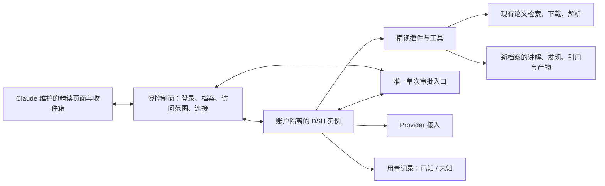

# 01 · 项目瘦身与 DSH 精读改造

日期：2026-10-27  
状态：用户 grill 已完成，范围与取舍已确认；新增前端数据接口待 Claude 提供。  
纲领：[WORKFLOW.md](../WORKFLOW.md)。Codex 设计；DS V4.1（DSH）实施、自审、测试；Claude 负责前端和最终验收。

## 1. 要解决什么

研究精读已有真实论文检索、下载、按页读取能力，但 OpenScience 桥接、双重审批、预算预留与用量围栏使正常流程反复中断。本轮用 DSH 加精读插件完成现有精读体验，同时让管控层缩为「访问控制 + 单次审批 + 取消 + 用量记录」。

目标是精读能完成、错误能收尾、用户能重来，并保住登录、账户隔离、档案、论文工具和收件箱。预算层瘦身是独立决定，不以更换内核是否带来改善为条件。

本轮不做对照实验、不增加边缘场景、不实施七台完整重构。此前大范围设计中的功能不自动成为本轮要求。

## 2. 用户已确认的决定

1. 研究运行内核使用 DeepSeek Harness（DSH），专业能力以插件和 tools 接入，必要时复用 MCP。
2. DSH 精读验收通过后退役旧内核，不保留双内核开关、自动回退或长期并行实现。最终交付必须同时满足 B2。
3. 不迁移、不保留旧业务记录。清空旧档案、会话、运行、审批、用量、记忆、论文缓存和生成产物。
4. 保留账号和 Provider 配置，包括必要的身份认证关联与凭据。源代码和 Git 历史不属于本次业务数据清理范围。
5. 调模型前不预留预算；用量未知不冻结账户、不阻塞任务；业务完成与费用核对分离。
6. 前端瘦身 F1～F3 由 Claude 实施；新增数据接口由 Claude 定义后提供，后端按其契约接线，不擅自更改界面或另定一套前端接口。
7. 本 PRD 不授权 Codex 编写实现或运行付费验收。具体执行和真实验收由既定角色按项目流程完成；既往走查预算不自动延用到本轮。

## 3. 验收标准（用户原文）

| 编号 | 验收：做什么 → 应该看到什么 |
|---|---|
| B1 | 精读在 DSH 上跑完 8 步（就是上次那张表：说想读哪篇 → 候选 → 都不是并补充 → 选定 → 只批一次下载 → 带页码的讲解和发现卡 → 已完成；拒绝下载显示「已停止 · 没有下载」；出错能结束、能重来） |
| B2 | `local:up --real-models` 不再启动 OpenScience，旧的 OpenScience 桥接层和专用插件退出运行路径 |
| B3 | 管控层变薄：调模型前不再预留预算；下载只出一张审批卡；用量缺失显示「未知」，但不阻塞、不冻结；读完就显示「已完成」，费用可以晚一点再核对 |
| B4 | 保留的东西照常工作：登录、账户隔离、档案、论文工具、收件箱；全量测试通过，已知失败的那几条另外列出 |

以下章节是实现边界与 B1～B4 的解释，不另加验收门槛。

## 4. 后端保留 / 改造 / 退役

路径以现有后端工作树 `/Users/guangjieyu/.codex/worktrees/research-foundation/ReinLab` 为基准；盘点基线为 `0298c89`，实施时应核对最新状态，不回退别人的改动。

| 模块 | 处置 | 本轮边界 |
|---|---|---|
| 登录、账户、数据库账户隔离 | 保留 | 现有账号仍能登录，身份与权限不依赖模型提供的账户参数 |
| 档案 API 与基础结构 | 保留并改造 | 空白起步，可创建并访问自己的新档案；解除 OpenScience project/session 绑定 |
| `services/control/src/mcp/papers.ts`、`paper-http.ts` 等论文能力 | 保留业务实现并适配 | 复用检索、获取全文、解析、页码与来源；修复阻塞 B1 的实际问题，不重写另一套论文服务 |
| 讲解、发现、引用及产物保存 | 保留并整理 | 插件调用业务能力，成果能被现有界面读取，引用能落到原文 |
| 收件箱与决策记录 | 保留业务能力、改接 DSH | 显示唯一审批请求；去掉原生权限与业务审批互相补答的机制 |
| `src/data/read-live.ts`、`read-projection.ts` 等 | 改造 | 采用 Claude 提供的前端契约；只做必要的事件/数据呈现映射，不重建内核状态机 |
| 业务事件与用量记录 | 保留并简化 | 关联账户、档案、任务和调用；记录不反向阻塞业务结束 |
| `services/control/src/bridge/openscience/` | 退役 | DSH 精读通过后移除旧桥接代码及专用调用入口 |
| `plugins/reinlab-os-plugin/`、`@synsci/sdk` / `@synsci/plugin` 专用依赖 | 退役 | 不留可启动的旧执行路径；可复用纯业务逻辑提取后使用 |
| `services/account-runtime/` 与 provisioner | 改造 | 保留必要账户隔离和文件卷管理；替换 OpenScience 的构建、启动和连接部分 |
| `services/control/src/budget/` 及模型/澄清路径中的预算门禁 | 退役执行门禁 | 移除预留、冻结、预算分配树对执行的依赖；正常用量记录不随之删除 |
| `mcp/authority.ts`、`token.ts`、`approval-bridge.ts` | 拆分改造 | 留访问范围与认证；去掉预算、hold、内核版本摘要耦合及双重审批 |
| `services/worker/` 中旧运行观察与对账任务 | 退役旧任务 | 不为保住 worker 而继续启动 OpenScience；无剩余用途的服务退出默认启动 |
| 工具与角色清单、contracts | 改造 | 留专业工具语义、输入输出约束和角色职责，清理不再使用的旧内核字段 |
| 原有测试 | 分类处理 | 保留业务回归；替换旧内核协议测试；删除仅验证已退役功能的测试及专用 fixture，不以删测试掩盖保留功能回归 |

不直接删除整个控制面、数据库、MCP 目录或账户运行目录。它们混有本轮必须保留的业务能力。

## 5. 最小目标结构

DSH 负责对话、模型和工具循环、会话压缩；插件负责精读行为与业务工具。控制面不再维护第二套 Agent 运行逻辑。

每账户独立运行实例及 DSH_HOME，使用已有隔离基础限制文件和服务访问。单靠 cwd、profile 或 session ID 不视为账户隔离。业务任务关联 DSH 会话，但不要求把业务状态机械地复制成 DSH 的所有内部状态。

使用已核实的官方无界面 SDK 接口，固定实际使用版本；不依赖桌面 UI。正常输出上限和压缩输出上限分别配置到可完成精读的水平，不继承旧网关 512/1024 的硬编码限制。本轮不指定新的统一数值，也不进行容量压测。

## 6. B1：精读插件与用户流程

插件需覆盖：多轮澄清、论文检索、用户选定、下载、按页读取、生成并保存讲解与发现、结束与取消。候选选择属于用户问答，下载属于审批，两者不能混成同一张权限卡。

| 步骤 | 用户动作 / 运行行为 | 必须得到的结果 |
|---|---|---|
| 1 | 在研究档案里说想读哪篇 | DSH 接住真实输入，开始讨论或检索 |
| 2 | 查看候选论文 | 候选来自真实检索，可供用户选择 |
| 3 | 点「都不是」并补充线索 | 回到同一段澄清对话，继续检索；不因补充而另建冲突运行 |
| 4 | 选定论文 | 记录用户选择，并按现有前端的开始阅读交互继续；不让 AI 代选 |
| 5 | 批准下载 | 只出现一次下载审批，用户批准后才下载 |
| 6 | 阅读讲解 | 基于实际读取内容生成，带可定位到论文页码的引用 |
| 7 | 查看发现卡 | 有真实内容与原文引用，保存到当前档案 |
| 8 | 精读结束 | 讲解和发现已保存，状态显示「已完成」，不等待费用核对 |

两条已定分支：

- 拒绝下载：不下载，显示「已停止 · 没有下载」，不显示完成阅读。
- 正常使用中遇到检索/模型/读取错误：结束当前执行并显示可理解原因，用户可以重来；不留下阻塞下一次操作的 running 或未知用量围栏。

已有资料实际只有摘要时仍须如实呈现，不能编造页码和全文。这里只复用已有论文能力，不增加 OCR、群研、自研、理解评分、动画或论文写作的新开发范围。

## 7. B3：管控层只保留四项职责

| 职责 | 留下什么 | 移除什么 |
|---|---|---|
| 访问控制 | 登录身份、账户/档案范围、工具可访问文件与服务范围 | 预算 hold、清单摘要或旧角色版本决定模型是否可调用 |
| 单次审批 | DSH 的一次请求，由现有页面/收件箱呈现并答复 | 控制面审批后再创建第二张原生权限卡、两套审批互相补答 |
| 取消 | 当前执行停止，新动作不再派发；状态按实际结果更新 | 因旧运行或费用未知而封锁整个账户 |
| 用量记录 | 按调用保存 Provider 返回的用量；缺失明确显示未知；可稍后更新 | 调用前预留、强制对账后才能收尾、未知转冻结 |

同进程工具使用可信执行上下文绑定范围，不为每次调用额外签发预算能力令牌。跨进程服务保留必要认证及服务端范围检查，但不把预算状态放进认证条件。

保持当前 Provider 凭据保护方式。若真实 key 仍只允许留在宿主，模型代理只做认证、注入凭据、转发和取消；不承担预算预留与冻结。不要为了改内核把 key 暴露给模型、浏览器或工具输出。

任务状态和用量状态独立：任务可以「已完成 + 用量未知」。用量缺失不能写成 0，估算不能伪装成 Provider 精确值。费用更新失败不改变已经成功保存的精读结果。

明确所用 DSH 重试策略，禁止外层与内核叠加重试造成请求放大；普通失败应能结束并由用户重来。本轮不开展重试策略对比、故障注入矩阵或压测。

## 8. 旧业务数据清空与配置保留

实施前区分身份/配置与业务数据，按外键和文件归属清理。用户已确认清空，不建立旧业务归档、不迁移旧会话、不保留旧业务备份来替代清空决定。

| 保留 | 清空 |
|---|---|
| 登录账号、认证关联与必要账号设置 | 旧档案、thread、run、event、artifact 业务记录 |
| Provider 地址、模型选择、凭据及必要密钥引用 | 旧审批、收件箱业务项、记忆、升级提议、委托 |
| 运行所需的身份与隔离配置 | 旧预算估计、allocation、hold、调用记录及旧运行令牌 |
| 源代码、Git 历史、设计文件与开发测试代码 | 旧论文资产/缓存、生成产物、账户卷内旧会话与业务文件、对应浏览器业务缓存 |

清理范围限定为本项目旧运行产生的业务数据，不扩大到用户其他目录、原始个人资料或其他服务的数据。不通过清空整个数据库/账户卷误删账号和 Provider 配置。浏览器侧清理由 Claude 根据前端范围处理，后端需告知重置影响。

清理是本轮一次性转换，不放进每次 `local:up`；新系统后续产生的档案和验收成果必须正常保存。先清空旧数据再用新档案验收，不在验收通过后又删掉新系统记录。

## 9. 前后端协作边界

Claude 负责 F1～F3、最终页面效果、新增前端数据接口。后端向 Claude提供以下语义，字段名、签名与组件组织待其契约确定：

- 澄清对话、真实候选、当前选定论文；
- 唯一下载审批及用户决定；
- 页码讲解、发现卡和来源定位；
- 执行中、已完成、已停止、失败及可理解原因；
- 已知用量/费用、未知标记，后续费用更新不改变业务完成状态。

DSH 实施不擅改前端样式、交互或另造接口；可先进行不依赖新增接口的 SDK 接入与业务工具改造。最终联调以 Claude 提供的契约为准，PRD 中不猜字段。

## 10. 实施与验收顺序

1. DSH 读取本 PRD，按 WORKFLOW.md 在用户开启的本轮分支执行 spec → TDD → 实现 → 自审 → 测试；核对实际代码与已知测试失败。
2. 保留账号/Provider 配置，清空旧业务数据；接入账户隔离的 DSH 与精读插件，复用论文、档案和产物能力。
3. 同步完成管控层瘦身，按 Claude 接口跑通 B1/B3；不做 OpenScience 与 DSH 对照实验。
4. Claude 确认 DSH 精读可用后，移除旧内核代码、专用依赖与启动链；最终 `local:up --real-models` 只走新内核，满足 B2。
5. DSH 在最终改造状态跑全量测试，交命令、结果和已知失败清单；Claude 验收 B1～B4。三方无问题后按流程合并，不由本 PRD 自动授权合并。

B4 的已知失败必须逐条列测试名称、失败原因、是否改造前已存在及对 B1～B4 的影响。不得把新回归归入“已知”直接放行；有失败时如实报告“其余通过、例外如下”，不能声称全绿。缺少既有失败名单时由实施方核实，不在设计阶段编造。

本轮只检查核心功能所需的登录、两账户基本隔离、新档案、真实论文工具、唯一收件箱审批与精读流程；不新增边缘场景验收、独立安全审计或重复证据工程。

## 11. 明确不做

- 双内核运行开关、自动回退、A/B 对照或基准比较。
- 旧业务数据迁移、只读历史库或旧运行恢复。
- 新预算产品、严格费用上限保证、复杂计价及账户费用围栏。
- 七台后端重构、完整长期记忆平台、管家、群研、自研、跨台委托。
- Data Formulator 或 OpenMAIC 新集成；现有可用课程能力不顺带破坏。
- Codex 实现代码、DSH 擅自修改 Claude 的前端、自动创建新分支或合并。

## 12. 设计依据

- [工作纲领](../WORKFLOW.md)
- [真实走查记录](../walkthroughs/2026-10-26-research-read/RESULTS.md)
- [七台目标设计（只作背景，不扩大本轮范围）](../DSH_WORKBENCH_DESIGN.md)
- [DSH TypeScript SDK（已核实源码快照）](https://github.com/deepseek-ai/deepseek-harness/blob/22ddee3792402c3e70ec5f86a63c3e3e895a2f60/packages/sdk/client/README.md)
- [DSH SDK 协议](https://github.com/deepseek-ai/deepseek-harness/blob/22ddee3792402c3e70ec5f86a63c3e3e895a2f60/packages/sdk/protocol/README.md)
- [DSH 单次审批](https://github.com/deepseek-ai/deepseek-harness/blob/22ddee3792402c3e70ec5f86a63c3e3e895a2f60/packages/interaction/user-approval/README.md)

以上 DSH 链接是设计时核实的参考快照，不要求实施方盲用该提交；实际固定版本须具备所需能力，并在 spec 中注明。
